# Documento Final de Arquitectura — SierraMar

**Plataforma Digital para la Gestión Integrada y Sostenible del Turismo en Santa Marta**

| | |
|---|---|
| **Universidad** | Universidad del Magdalena — Facultad de Ingeniería, Programa de Ingeniería de Sistemas |
| **Asignatura** | Arquitectura de Software, 2026-II |
| **Equipo** | Grupo 4: Carlos Sehuanes (arquitecto), Luis Rincón (analista de requisitos), David Hasbum (diseñador de datos), Santiago Criollo (desarrollador principal), Julián Tobias (responsable de validación) |
| **Fecha** | Noviembre de 2026 |
| **Demo en línea** | https://20-226-88-58.sslip.io |
| **Repositorio** | https://github.com/Csehuanes-code/capstone-project-documentation |

Este documento cierra la fase de diseño. Parte de los requisitos, restricciones y escenarios de calidad ya entregados (`deliverables/requirements-document/`) y de la comparación de propuestas arquitectónicas (`architectural-proposals.md`). Todo lo que se describe aquí está implementado en el prototipo y desplegado en la nube: los diagramas reflejan el código y la infraestructura reales, no una intención.

---

## 1. Estilo arquitectónico

### 1.1 Estilo elegido

> **SierraMar usa una arquitectura de microservicios ligeros orientados al dominio, con un API Gateway como única entrada, comunicación híbrida (REST síncrono para consultas y eventos asíncronos sobre RabbitMQ para propagar hechos) y Clean Architecture dentro de cada servicio. El cliente es una aplicación web progresiva (PWA).**

Es la variante **A2** del documento de propuestas: pocos servicios, contenedores ligeros y un gateway simple, sin Kubernetes ni service mesh. Hay cinco microservicios, uno por contexto de negocio, y cada uno es dueño de su base de datos.

| Microservicio | Responsabilidad | Base de datos | Responsable |
|---|---|---|---|
| **Auth** | Registro, confirmación de correo, sesiones JWT, roles, consentimiento (Ley 1581), verificación de prestadores | `auth_db` | David Hasbum |
| **Catálogo** | Zonas, tipos de servicio, ofertas bilingües, tarifas, políticas de cancelación, calificaciones | `catalogo_db` | Luis Rincón |
| **Reservas** | Franjas y cupos, reservas, pagos (pasarela simulada), cancelaciones, lista de espera, disputas, envío de correos | `reservas_db` | Santiago Criollo |
| **IA — Recomendación** | Recomendaciones explicables con puntaje multicriterio y alternativas a zonas saturadas | `ia_db` | Julián Tobias |
| **Analítica** | Indicadores por zona, capacidad de carga, alertas y ocupación | `analitica_db` | Carlos Sehuanes |

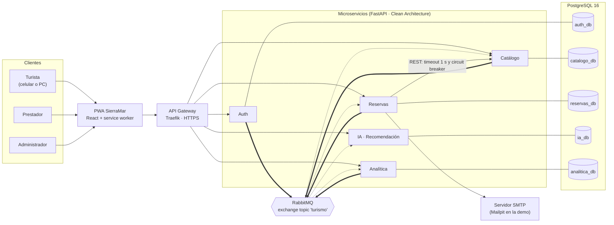

*Figura 1. Vista general. Flechas gruesas hacia RabbitMQ: servicios que publican eventos. Flechas punteadas desde RabbitMQ: servicios que los consumen. Los servicios no comparten base de datos; lo que necesitan de otro dominio lo reciben por eventos.*

### 1.2 Por qué responde a las restricciones económicas

| Restricción | Cómo la cumple el estilo elegido | Evidencia |
|---|---|---|
| **RC-E01** Presupuesto ≤ USD 20.000 para infraestructura | Todo el sistema corre en **una máquina virtual** con Docker Compose: gateway, broker, base de datos, 5 servicios y frontend. No hace falta Kubernetes, service mesh ni bases gestionadas. | La VM de Azure (2 vCPU, 8 GiB) cuesta **0,153 USD/h ≈ USD 112/mes**. Un año de piloto encendido todo el tiempo cuesta unos **USD 1.340**, el 6,7 % del presupuesto. |
| **RC-E02** Software libre y nube de bajo costo | Todo el stack es de código abierto: Python, FastAPI, PostgreSQL, RabbitMQ, Traefik, React, Vite y Let's Encrypt. | No se paga ninguna licencia. El certificado HTTPS es gratuito. |
| **RC-E03** Cinco estudiantes con roles fijos y evaluación individual | Un microservicio por integrante: cada uno diseña, prueba y sustenta su dominio con límites claros, sin pisar el código de otro. | Cada servicio tiene su carpeta, su CI en GitHub Actions y sus pruebas. |
| **RC-E04** 12 semanas | Se limitó el alcance a 5 servicios y una **plantilla común** (`comun/`) que resuelve una sola vez JWT, outbox, consumidores idempotentes, logs y health checks. | Los 5 servicios se integraron y desplegaron dentro del plazo. |

El ahorro frente a la variante "enterprise" (A1) es grande: un clúster Kubernetes gestionado con tres nodos y un service mesh pasa fácilmente de USD 400/mes, y además exige alguien dedicado a la plataforma. Con Compose, el mismo archivo levanta el sistema en el portátil de cualquier integrante y en la nube.

### 1.3 Por qué responde a las restricciones técnicas de conectividad

El turista usa la plataforma desde el celular, muchas veces en zonas naturales con **cobertura móvil intermitente**: Tayrona, Minca, la Sierra (requisitos, supuesto RC-D01; RC-T01). Además, los servicios se comunican entre sí por red y cualquiera puede caerse. El estilo responde en tres niveles, detallados en el **ADR-05**:

1. **Entre el celular y la plataforma.** La PWA guarda la aplicación y las fotos en el dispositivo (service worker), así que abre y se navega aunque la señal sea mala. Cada pago lleva una **clave de idempotencia**: si la red se corta y el turista vuelve a pulsar «Pagar», no se cobra dos veces. El comprobante llega también por correo, para tenerlo sin conexión.
2. **Entre servicios.** Los hechos de negocio viajan como eventos con **outbox transaccional**. Si RabbitMQ no está disponible, el evento queda guardado y se publica cuando vuelva. Los consumidores son **idempotentes**, los mensajes que fallan van a una **cola de errores (dead-letter)** y cada servicio guarda **proyecciones locales** de lo que necesita de otros. Así puede seguir atendiendo aunque el otro servicio esté caído.
3. **Llamadas síncronas mínimas.** Ningún servicio llama a Auth en cada petición: validan el JWT localmente con la clave pública. La única llamada síncrona del flujo crítico (Reservas pide a Catálogo las condiciones de la oferta) tiene **timeout de 1 s y circuit breaker**.

### 1.4 Por qué responde a los atributos de calidad prioritarios

| Atributo (escenario) | Mecanismo del estilo | Implementado en |
|---|---|---|
| **Disponibilidad ≥ 99 %** (EC-DISP-01/02) | Aislamiento de fallos por servicio. Health checks `/health/ready`. El gateway solo enruta a servicios sanos. Los contenedores se reinician solos (`restart: unless-stopped`). El outbox evita perder eventos. | `comun.salud`, `docker-compose.nube.yml` |
| **Desempeño bajo concurrencia** (EC-DESM-01/02, RC-T03) | Las lecturas pesadas (catálogo, recomendaciones) no compiten con las transacciones de Reservas. El cupo se descuenta con un `UPDATE … WHERE cupo_disponible >= n` atómico, sin bloqueos largos. | Reservas, `repositorios.py` |
| **Escalabilidad y evolución** (EC-ESC-01, EC-EVOL-01, RC-T05) | Cada servicio escala por separado detrás del gateway. Un consumidor nuevo se agrega suscribiéndose a un evento, sin tocar al productor. Los contratos están versionados en `contratos/`. | Analítica e IA se agregaron como consumidores de `reservas.reserva.confirmada` sin cambiar Reservas. |
| **Seguridad y Ley 1581** (EC-SEG-01/02, RC-N01–N04) | Contraseñas con Argon2id. JWT ES256 de 15 min firmados solo por Auth. Roles verificados en cada servicio. Consentimiento y auditoría en Auth. HTTPS (TLS) en el gateway. RabbitMQ y PostgreSQL no se exponen a internet. | Auth, `comun.seguridad`, Traefik |
| **Mantenibilidad** (EC-MANT-01, RC-ARQ04) | Clean Architecture en cada servicio, con reglas de dependencia verificadas por **import-linter** en la CI. Más de 360 pruebas automatizadas (Auth 71, Catálogo 89, Reservas 35, Analítica 24, IA ≈ 148, `comun` 11). | `.importlinter`, `.github/workflows/` |
| **Explicabilidad de la IA y ausencia de sesgo** (EC-IA-01/02, RC-ET01/02) | La IA es un servicio aparte con pesos versionados y auditables. Cada recomendación devuelve el desglose de su puntaje. | IA, `configuracion_criterios` |
| **Sostenibilidad** (EC-SOST-01, RC-A01/A04) | Analítica calcula la ocupación por zona contra su capacidad de carga y publica `analitica.zona.ocupacion_actualizada`. Con eso la IA propone alternativas en zonas tranquilas. | Analítica → IA |
| **Multilenguaje y accesibilidad** (EC-MULTI-01, EC-ACC-01) | Toda la interfaz y los correos están en español e inglés. La PWA es adaptable desde 360 px y usa HTML semántico. | PWA, plantillas de correo |

### 1.5 Alternativas descartadas

El documento de propuestas evaluó cuatro opciones con una tabla ponderada (máximo 35 puntos):

| Alternativa | Puntaje | Decisión | Motivo principal |
|---|---|---|---|
| **A2. Microservicios ligeros** | **27** | **Elegida** | Ver arriba |
| B. Monolito modular (con IA aparte) | 26 | Descartada | Ver explicación abajo |
| A3. Microservicios serverless | 24 | Descartada | Los arranques en frío afectan las consultas interactivas. Las reservas con pago necesitan un motor de flujos adicional. Ata el proyecto a un proveedor de nube. |
| C. Capas tradicional (cliente-servidor 3 capas) | 21 | Descartada | Una falla en cualquier función tumba todo el sistema, lo que no cumple el 99 %. No separa dominios y no permite demostrar mantenibilidad ni evolución. |
| A1. Microservicios con Kubernetes + service mesh | — | Descartada antes de puntuar | Costo y curva de aprendizaje incompatibles con USD 20.000 y 12 semanas. |

**Por qué no el monolito modular, si quedó a un punto.** La propuesta inicial recomendaba un monolito modular con la IA como servicio aparte. Al pasar a la implementación pesaron tres razones que la tabla no capturaba:

1. **Organización del equipo (RC-E03).** La evaluación es individual por rol y cada integrante debía sustentar una pieza propia. Con microservicios, cada persona tiene un límite de código, de datos y de despliegue que puede defender sola. En un monolito, el trabajo de cinco personas en un mismo desplegable generaba choques constantes.
2. **Cargas distintas y aislamiento de fallos.** La IA y Analítica hacen cálculos que no deben afectar la reserva, que es el flujo crítico. Separadas, una falla o un pico en ellas no detiene las ventas.
3. **El riesgo principal del estilo se controló.** El temor era que la complejidad operativa consumiera el plazo. Se mitigó con la variante A2 en su forma más austera: 5 servicios, Docker Compose, Traefik y una plantilla común. La integración completa se logró dentro de las 12 semanas.

Lo que se sacrifica: hay más piezas que operar, y la consistencia entre servicios es **eventual**. Por ejemplo, la popularidad en IA se actualiza segundos después de una reserva, no en el mismo instante. Se acepta porque ningún dato que se propaga por eventos es crítico para cobrar o asignar un cupo. Esas decisiones ocurren dentro de una sola transacción local de Reservas.

---

## 2. Modelo de datos

### 2.1 Modelo conceptual del dominio

Las entidades de negocio y sus relaciones, sin detalle de implementación (nivel arquetipo, como pidió el docente en la revisión del primer laboratorio). Cada color de paquete corresponde al microservicio dueño de la entidad.

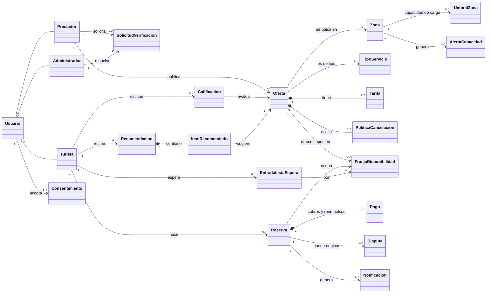

*Figura 2. Modelo conceptual. Auth: Usuario, Consentimiento, SolicitudVerificacion. Catálogo: Zona, TipoServicio, Oferta, Tarifa, PoliticaCancelacion, Calificacion. Reservas: FranjaDisponibilidad, Reserva, Pago, EntradaListaEspera, Disputa, Notificacion. IA: Recomendacion, ItemRecomendado. Analítica: UmbralZona, AlertaCapacidad.*

Reglas de negocio que el modelo hace explícitas:

- Una reserva ocupa cupos de **una** franja. La suma de personas reservadas nunca supera el `cupo_total` (no hay sobreventa).
- La reserva **copia** el precio y la política de cancelación vigentes al momento de reservar. Si el prestador cambia la tarifa después, no afecta lo ya vendido.
- Un pago es un cobro o un reembolso. Una reserva puede tener ambos tras una cancelación.
- Solo un turista con una reserva **completada** de una oferta puede calificarla.

### 2.2 Modelo lógico

Cada microservicio tiene su propio esquema en una base de datos aparte. Las referencias a entidades de otro servicio (por ejemplo `oferta_id` dentro de Reservas) son **identificadores lógicos sin llave foránea física**: la integridad entre servicios la mantienen los eventos, no la base de datos. Se muestran las columnas principales. Las tablas técnicas `outbox` y `evento_procesado` existen en todos los servicios y se explican en la sección 2.3.

**Auth (`auth_db`)**

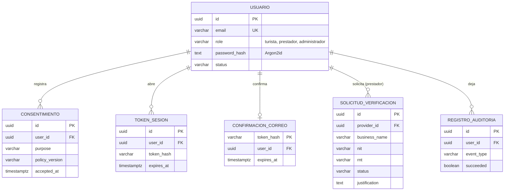

**Catálogo (`catalogo_db`)**

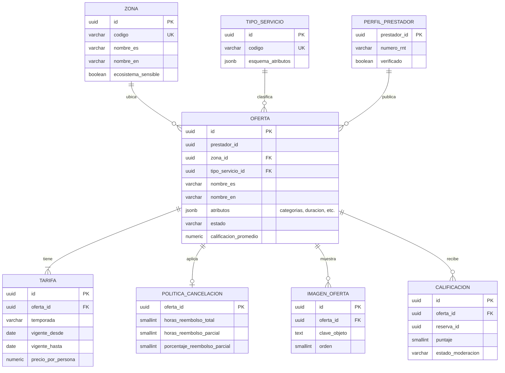

**Reservas (`reservas_db`)**

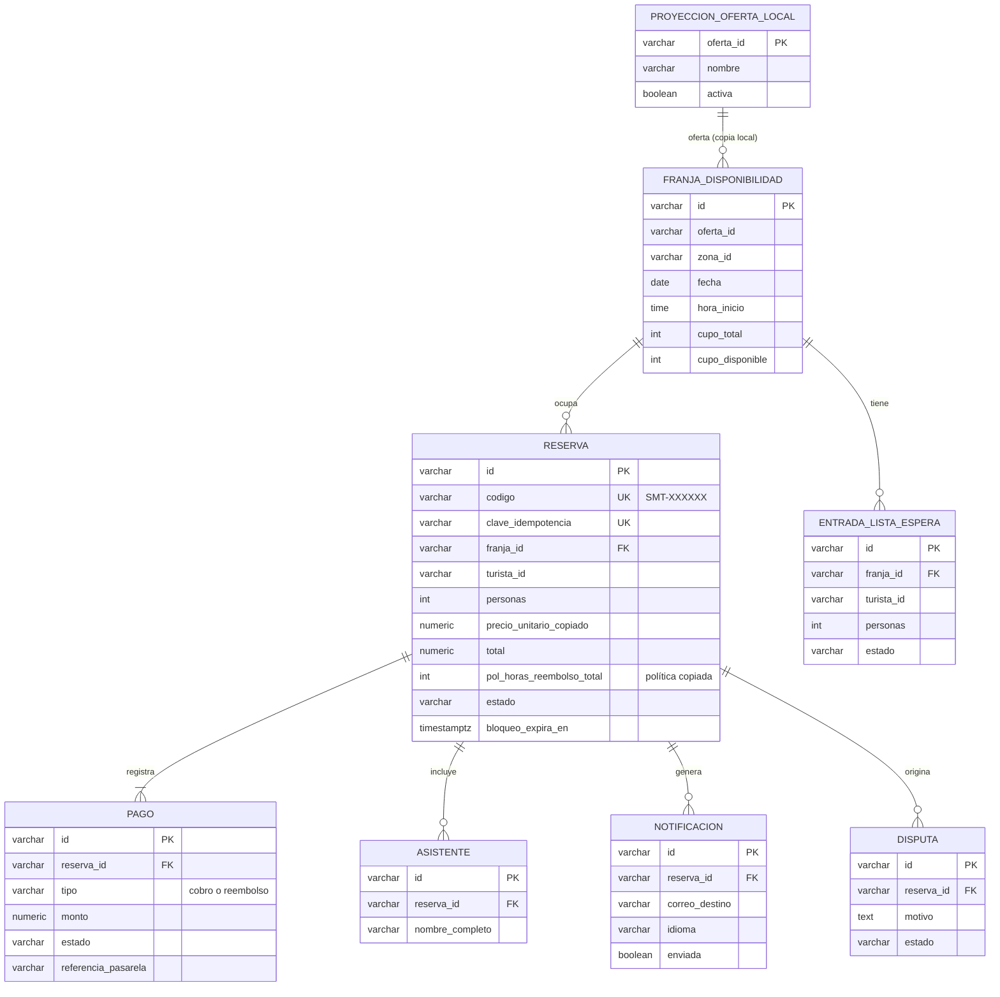

**IA (`ia_db`) y Analítica (`analitica_db`)**

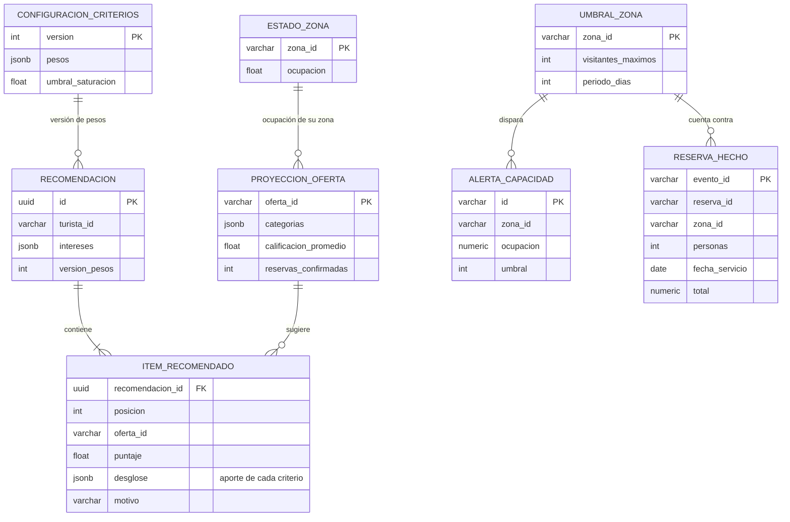

*Figuras 3 a 6. Modelo lógico por servicio. Las tablas de IA y Analítica que empiezan por `proyeccion_`, `estado_` o `reserva_hecho` son copias de lectura alimentadas por eventos de otros servicios.*

### 2.3 Justificación del modelo de persistencia

**Decisión (ADR-03):** un solo motor, **PostgreSQL 16**, con **una base de datos por microservicio** (patrón *database per service*), alojadas en la misma instancia durante el piloto.

1. **Por qué relacional.** Los datos centrales son transaccionales y deben ser exactos. Si el cupo se descuenta y el pago queda aprobado, eso tiene que ocurrir junto o no ocurrir. Lo mismo vale para el consentimiento y la auditoría que exige la Ley 1581 y para los reembolsos. PostgreSQL da transacciones ACID, llaves únicas (código de reserva, clave de idempotencia) y actualizaciones condicionales atómicas, que es lo que impide la sobreventa.
2. **Por qué no persistencia políglota.** La propuesta inicial sugería una base documental (MongoDB) para el catálogo, porque cada tipo de atractivo tiene atributos distintos. Se resolvió con columnas **JSONB** dentro de PostgreSQL (`oferta.atributos`, `tipo_servicio.esquema_atributos`): se tiene esquema flexible donde hace falta y relacional en todo lo demás, con un solo motor que aprender, respaldar y monitorear. Un segundo motor no aportaba nada que el piloto necesitara y sí agregaba costo operativo (RC-E01, RC-E04).
3. **Por qué una base por servicio.** Ningún servicio puede leer ni escribir la base de otro. Así se respeta la autonomía de cada microservicio y una migración en Catálogo no puede romper Reservas. También se aísla la información comercial de los prestadores (RC-N03). Que compartan instancia es una decisión de costo del piloto: cada base tiene su propio usuario y contraseña, y separarlas en instancias distintas no exige cambiar código.
4. **Tablas técnicas que sostienen la integración:**
   - `outbox`: el evento se guarda en la **misma transacción** que el cambio de negocio y un proceso aparte lo publica en RabbitMQ. Nunca hay un cambio sin evento ni un evento sin cambio.
   - `evento_procesado`: registra los eventos ya consumidos para que un mensaje repetido no se aplique dos veces.
   - `proyeccion_*` y `reserva_hecho`: copias de lectura de datos de otros servicios (CQRS ligero). Permiten que IA y Analítica respondan sin consultar en línea a Catálogo ni a Reservas.
5. **Evolución prevista.** Si la carga crece: réplicas de lectura para Catálogo e IA, caché (Redis) para las consultas más frecuentes y separar `reservas_db` en su propia instancia. Ninguna de estas mejoras cambia el modelo lógico.

---

## 3. Diseño de interfaces

### 3.1 Criterios de diseño

| Restricción | Criterio aplicado |
|---|---|
| RC-S01 Baja alfabetización digital | Reservar toma **3 pantallas** (Inicio → Detalle → Comprobante), por debajo del máximo de 5. Lenguaje claro y botones con verbos concretos («Pagar y reservar»). |
| RC-S02 Español e inglés | Selector ES/EN siempre visible en la cabecera. Cambia toda la interfaz al instante y los servicios responden en el idioma elegido. |
| RC-S04 Accesibilidad (WCAG 2.1 AA) | HTML semántico, foco visible, contraste suficiente, textos alternativos en imágenes y respeto de `prefers-reduced-motion`. |
| RC-T01 Celular y web | Diseño adaptable desde 360 px, barra de navegación inferior en el celular e instalable como app (PWA). |
| RC-ET01 IA explicable | Cada recomendación muestra su puntaje y un panel «¿Por qué veo esto?» con el aporte de cada criterio. |

Las pantallas se diseñaron primero como bocetos de baja fidelidad y se llevaron directamente a la PWA. Las figuras de esta sección son **mockups de alta fidelidad** tomados de la aplicación funcionando, con los datos de demostración.

### 3.2 Navegación principal

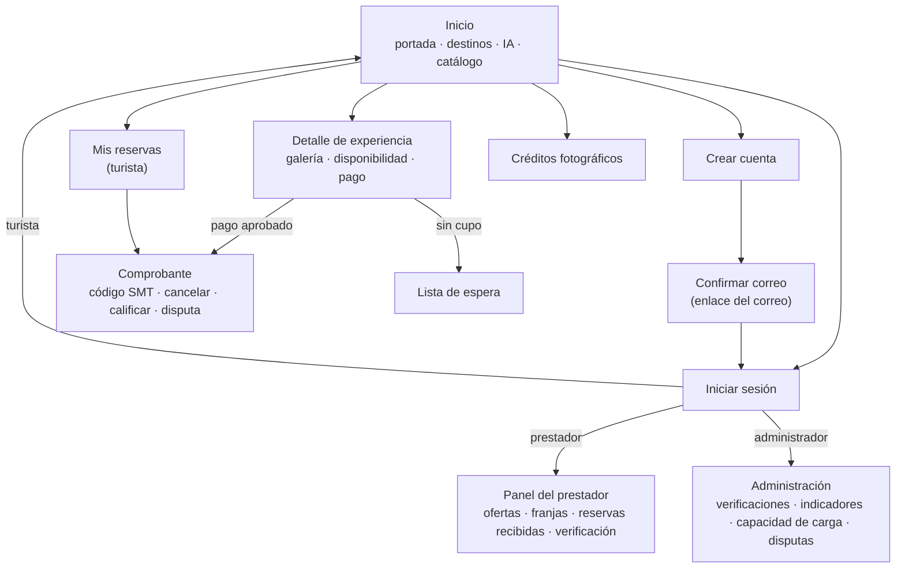

*Figura 7. Mapa de navegación por rol. Las rutas de turista, prestador y administrador están protegidas por rol en la PWA, y cada microservicio vuelve a verificar el rol en el token.*

### 3.3 Mockups

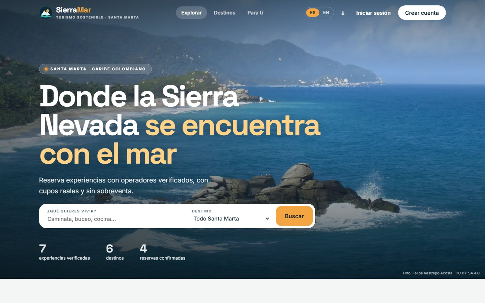
*Figura 8. Inicio: buscador con filtro de destino y cifras en vivo (experiencias, destinos y reservas confirmadas, estas últimas tomadas de IA).*

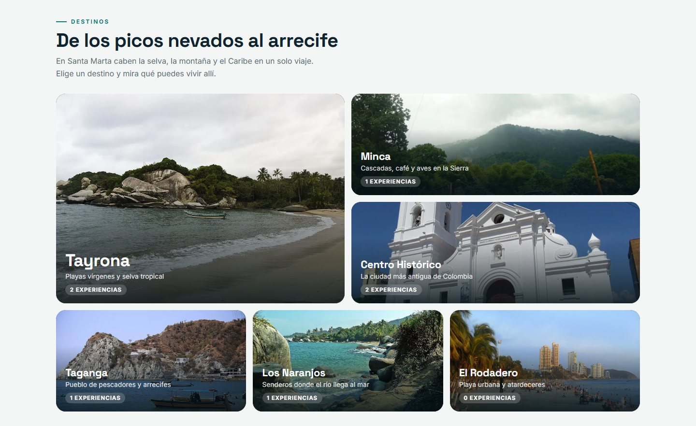
*Figura 9. Destinos: al pulsar una zona se filtra el catálogo. El número de experiencias de cada zona sale de Catálogo.*

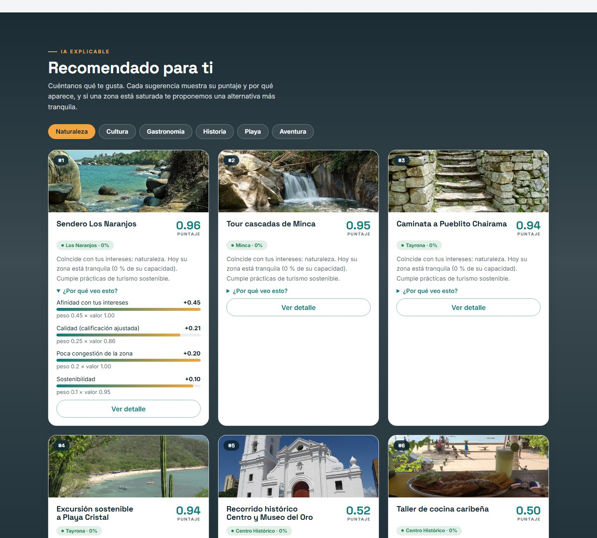
*Figura 10. Recomendaciones de la IA según los intereses elegidos, con puntaje, nivel de ocupación de la zona (dato de Analítica) y el desglose «¿Por qué veo esto?».*

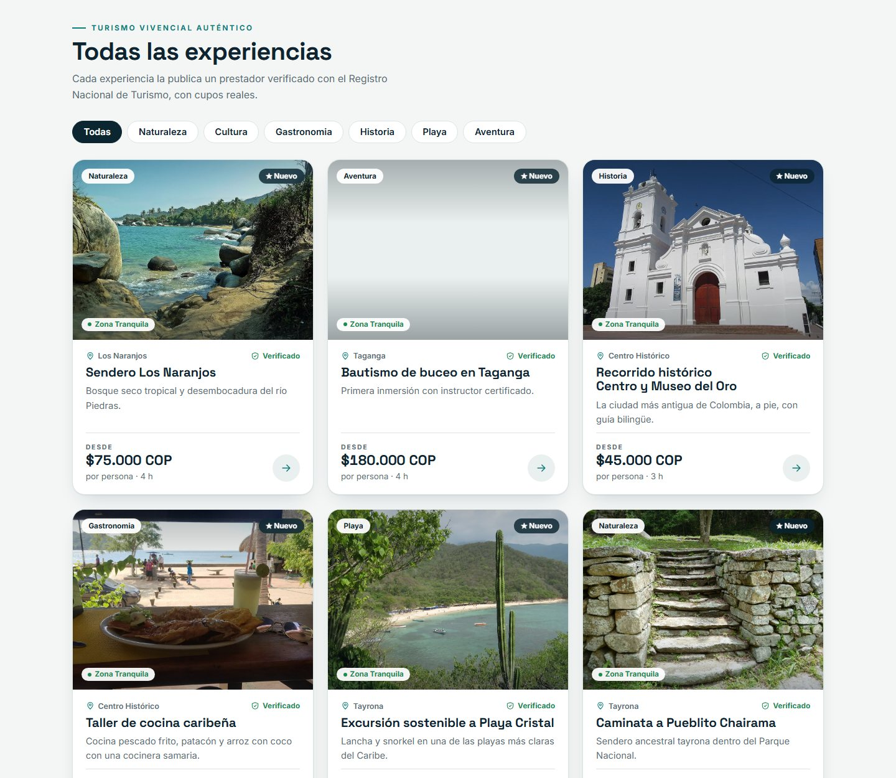
*Figura 11. Catálogo de experiencias de prestadores verificados, con precio desde, duración y aforo de la zona.*

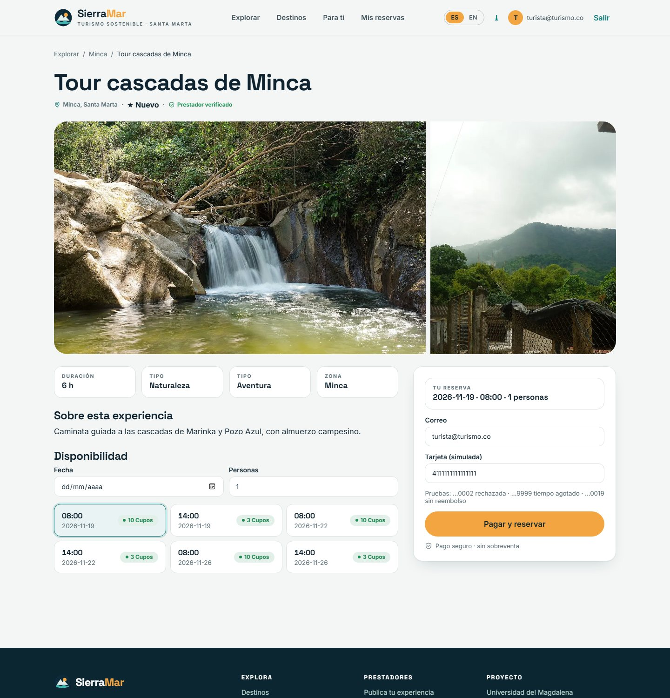
*Figura 12. Detalle de la experiencia: galería, datos clave, política de cancelación, franjas con cupos reales y formulario de pago.*

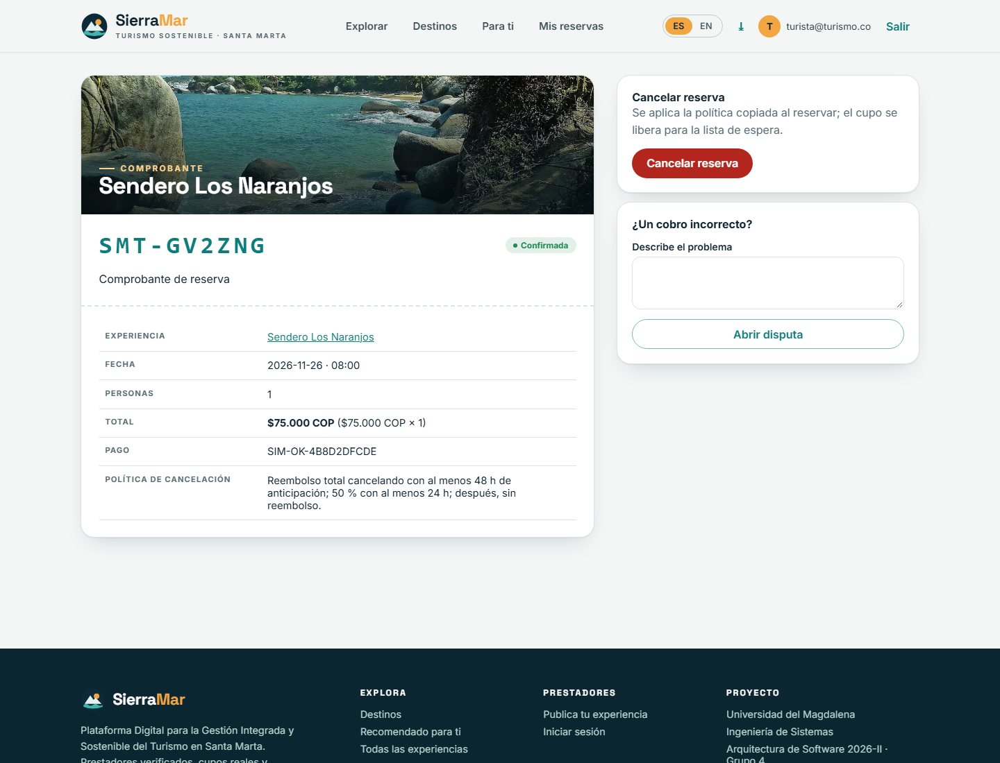
*Figura 13. Comprobante con código de reserva, política copiada al reservar y acciones del turista: cancelar, calificar y abrir disputa.*

| | |
|---|---|
| 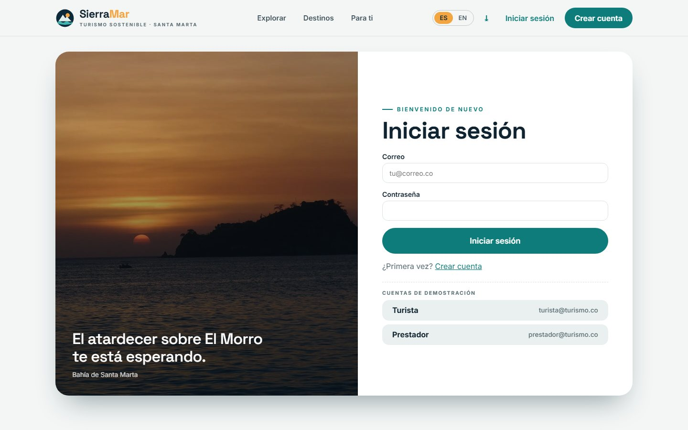 | 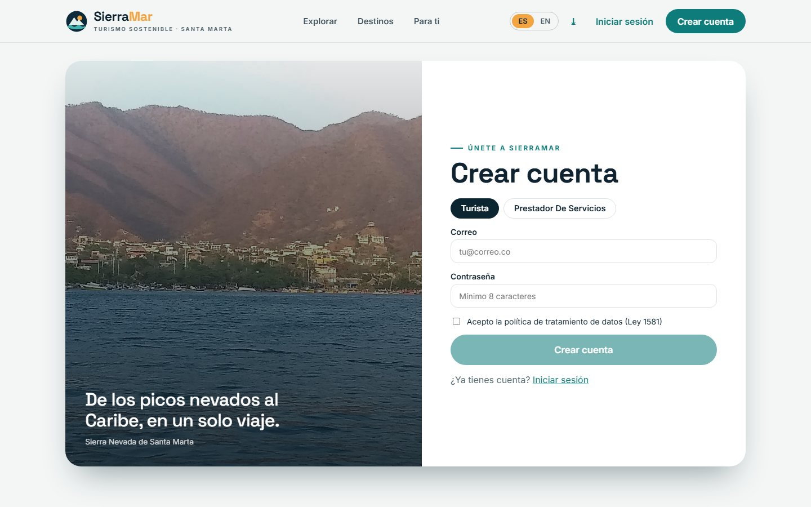 |
| *Figura 14. Iniciar sesión.* | *Figura 15. Crear cuenta con consentimiento de datos (Ley 1581).* |

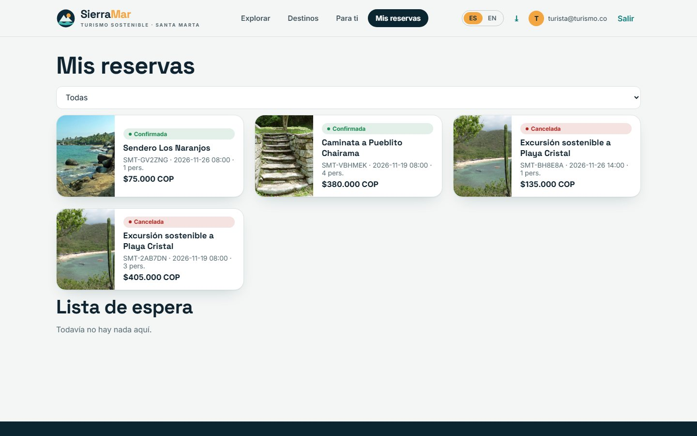
*Figura 16. Mis reservas del turista, con estado de cada una y lista de espera.*

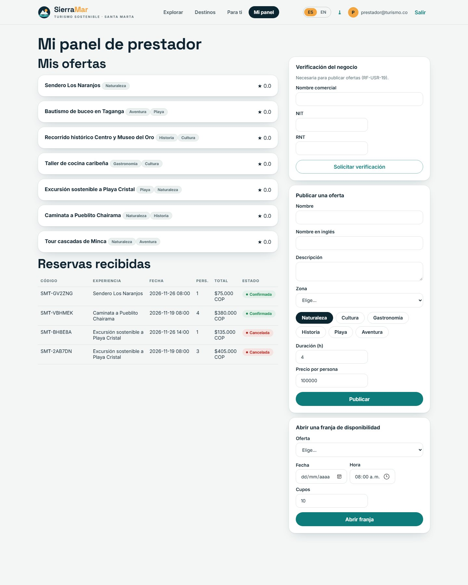
*Figura 17. Panel del prestador: sus ofertas, reservas recibidas, solicitud de verificación (RNT), publicación de ofertas y de franjas de disponibilidad.*

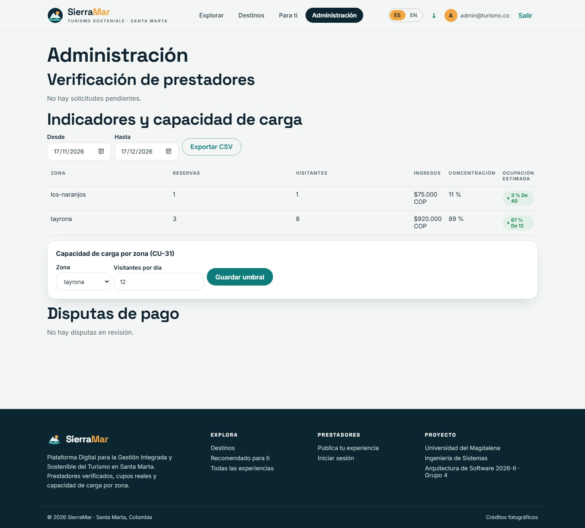
*Figura 18. Administración: verificación de prestadores, indicadores y capacidad de carga por zona (exportables a CSV) y disputas de pago.*

| | |
|---|---|
| 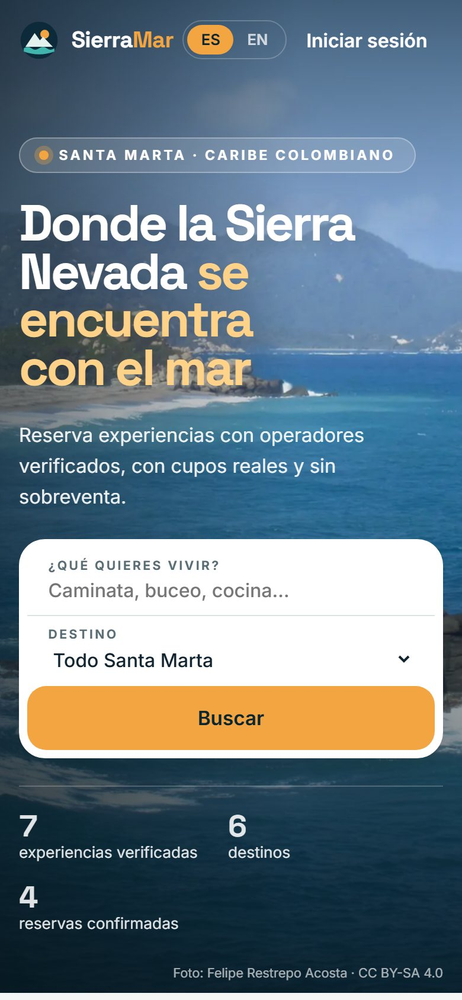 | 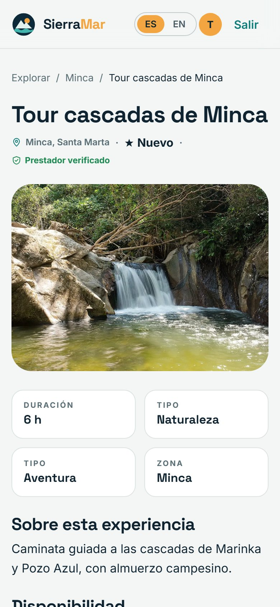 |
| *Figura 19. Inicio en celular (390 px).* | *Figura 20. Detalle en celular.* |

### 3.4 Coherencia con la arquitectura

Cada pantalla consume solo la API del gateway, y cada bloque de la pantalla corresponde a un microservicio. Así la interfaz deja ver la arquitectura: si un servicio falla, solo se degrada su bloque. Por ejemplo, si IA no responde, el catálogo y las reservas siguen funcionando.

| Pantalla | Bloque | Microservicio y endpoint | Eventos relacionados |
|---|---|---|---|
| Inicio | Destinos y catálogo | Catálogo `GET /api/v1/catalogo/zonas`, `/ofertas` | — |
| Inicio | Recomendaciones y aforo | IA `GET /api/v1/ia/recomendaciones`, `/populares` | IA consume `catalogo.oferta.*`, `reservas.reserva.confirmada`, `analitica.zona.ocupacion_actualizada` |
| Crear cuenta / Iniciar sesión | Formulario | Auth `POST /api/v1/auth/usuarios`, `/sesiones` | `auth.notificacion.solicitada` → Reservas envía el correo |
| Detalle | Datos, tarifa y política | Catálogo `GET /api/v1/catalogo/ofertas/{id}` | — |
| Detalle | Franjas y pago | Reservas `GET /api/v1/ofertas/{id}/disponibilidad`, `POST /api/v1/reservas` (con `Idempotency-Key`) | Reservas publica `reservas.reserva.confirmada` → IA y Analítica |
| Comprobante | Reserva y acciones | Reservas `GET /api/v1/reservas/{id}`, `/cancelar`, `/disputas`; Catálogo `/calificaciones` | Catálogo consulta a Reservas si la reserva está completada antes de aceptar una calificación |
| Panel del prestador | Ofertas y franjas | Catálogo `POST /ofertas`, `/tarifas`; Reservas `POST /api/v1/prestador/franjas` | `catalogo.oferta.publicada` → IA y Reservas |
| Administración | Verificaciones | Auth `GET/POST /api/v1/auth/admin/verificaciones` | `auth.prestador.verificacion_resuelta` → Catálogo |
| Administración | Indicadores y umbrales | Analítica `GET /indicadores`, `/alertas`, `PUT /umbrales` | Analítica publica `analitica.zona.ocupacion_actualizada` → IA |

---

## 4. Componentes de la arquitectura (diagrama de paquetes)

### 4.1 Paquetes del sistema

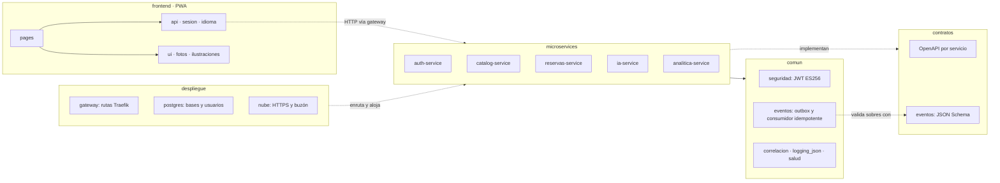

*Figura 21. Paquetes de primer nivel del repositorio. `comun` no tiene lógica de negocio y solo lo usan las capas externas (api e infraestructura) de cada servicio.*

### 4.2 Estructura interna de cada microservicio

Los cinco servicios siguen la misma Clean Architecture. Las dependencias solo apuntan hacia el dominio, y el dominio y la aplicación no importan frameworks web ni de persistencia. La regla está escrita como contrato de **import-linter** y la CI falla si alguien la rompe.

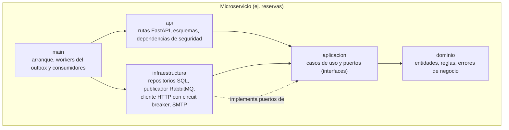

*Figura 22. Capas de cada microservicio. Los nombres reales de los paquetes son `auth_service.{api,application,domain,infrastructure}`, `catalog_service.{…}`, `reservas.{api,aplicacion,dominio,infraestructura}`, `ia.{…}` y `analitica.{api,aplicacion,dominio,persistencia,eventos,worker}`.*

| Microservicio | dominio | aplicacion | infraestructura | api |
|---|---|---|---|---|
| Auth | Usuario, roles, consentimiento, verificación | Registrar, confirmar, iniciar sesión, resolver verificación | Argon2id, firma ES256, PostgreSQL, publicador RabbitMQ | `/api/v1/auth/*`, `/.well-known/jwks.json` |
| Catálogo | Oferta, tarifa, política, calificación | Publicar oferta, consultar, calificar | PostgreSQL + JSONB, cliente de Reservas, consumidor de verificación | `/api/v1/catalogo/*` |
| Reservas | Franja, reserva, pago, lista de espera, disputa | Reservar, cancelar con reembolso, ofrecer cupo de lista de espera | PostgreSQL, pasarela simulada, SMTP, cliente de Catálogo con circuit breaker | `/api/v1/reservas`, `/ofertas/{id}/disponibilidad`, `/prestador/*` |
| IA | Criterios, puntaje, alternativas | Recomendar, explicar, proyectar ofertas y zonas | PostgreSQL, consumidores de Catálogo, Reservas y Analítica | `/api/v1/ia/*` |
| Analítica | Indicador, umbral, alerta | Registrar hecho, recalcular ocupación cada 60 s | PostgreSQL, consumidor de Reservas, publicador de ocupación | `/api/v1/analitica/*` |

---

## 5. Despliegue (diagrama de despliegue)

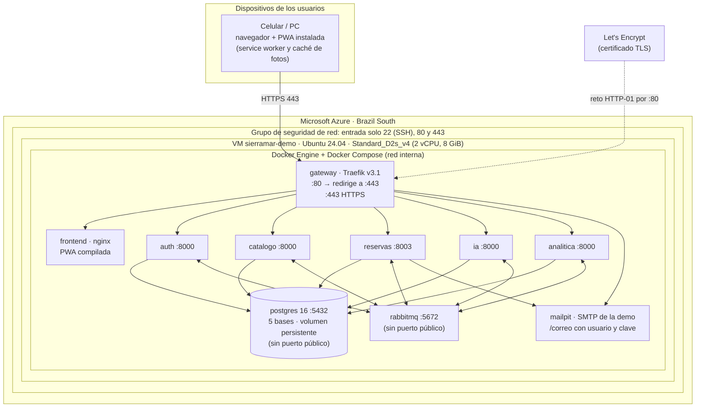

*Figura 23. Despliegue del piloto en Azure.*

| Nodo / artefacto | Detalle |
|---|---|
| **Máquina virtual** | Azure, región Brazil South (la más cercana a Colombia disponible para la suscripción), Ubuntu Server 24.04, 2 vCPU, 8 GiB de RAM, 30 GB de disco e IP pública estática. 0,153 USD/h. |
| **Contenedores** | 10 contenedores definidos en `docker-compose.yml` + `docker-compose.nube.yml`, con reinicio automático. |
| **Entrada** | Solo Traefik publica puertos (80 y 443). El certificado TLS se obtiene y renueva solo con Let's Encrypt para el dominio `20-226-88-58.sslip.io`. El puerto 80 solo redirige a HTTPS. |
| **Red interna** | Los servicios, RabbitMQ y PostgreSQL solo son accesibles dentro de la red de Docker. Los paneles de RabbitMQ y Traefik no se publican. |
| **Secretos** | Las claves ES256 de Auth se generan en el servidor (`despliegue/nube/preparar.sh`). Las contraseñas de admin y del buzón están en un `.env` con permisos 600 que no se versiona. |
| **Entornos** | **Local**: el mismo Compose en el portátil de cada integrante (`localhost:8080`). **Nube**: Compose base más el archivo de nube. Pasar de uno al otro no requiere cambiar código. |
| **Ruta de crecimiento** | Mover PostgreSQL a un servicio gestionado, poner varias VMs detrás de un balanceador o migrar los mismos contenedores a un orquestador gestionado (Azure Container Apps o Kubernetes). Las imágenes no cambian. |

---

## 6. Registro de decisiones arquitectónicas (ADR)

Formato de cada ADR: contexto, decisión, alternativas consideradas, consecuencias y restricciones que la condicionan. La numeración continúa la trazabilidad del documento de requisitos.

### ADR-01 — Metodología de desarrollo

- **Estado:** Aceptada (sprint 1).
- **Contexto:** Cinco estudiantes con roles fijos, 12 semanas y cuatro entregables formales con fecha (RC-E03, RC-E04). La arquitectura debía decidirse con evidencia y no congelarse al inicio.
- **Decisión:** **Scrum adaptado con revisiones arquitectónicas ligeras tipo ATAM (ATAM-lite)**, en 6 sprints de 2 semanas. Cada sprint cierra con una revisión de escenarios de calidad y riesgos sobre las decisiones del sprint. Se trabaja en ramas con pull requests revisados y CI obligatoria por servicio.
- **Alternativas:**
  - **Cascada:** exige congelar requisitos antes de diseñar, y aquí la arquitectura se decidió con evidencia incremental.
  - **Scrum puro:** sin revisiones de arquitectura, el diseño tiende a degradarse.
  - **Kanban:** no se alinea con entregas formales con fecha.
- **Consecuencias:**
  - (+) Los sprints coinciden con los entregables, y el cambio de monolito modular a microservicios se tomó con información real (ver ADR-02).
  - (−) Las revisiones ATAM-lite cuestan tiempo de reunión en cada cierre de sprint.

### ADR-02 — Estilo arquitectónico

- **Estado:** Aceptada. Reemplaza la recomendación preliminar de monolito modular del documento de propuestas.
- **Contexto:** Disponibilidad ≥ 99 % (RC-T04), alta concurrencia estacional (RC-T03), crecimiento progresivo (RC-T05), separación de componentes (RC-ARQ04), equipo de 5 con evaluación individual (RC-E03), 12 semanas (RC-E04) y USD 20.000 (RC-E01).
- **Decisión:**
  - **Microservicios ligeros orientados al dominio** (variante A2): 5 servicios (Auth, Catálogo, Reservas, IA, Analítica), un API Gateway (Traefik) y comunicación híbrida. REST para consultas y eventos en RabbitMQ (exchange topic `turismo`) para propagar hechos.
  - Clean Architecture dentro de cada servicio y PWA como cliente.
  - El flujo crítico (cupo + pago + reserva) ocurre en **una transacción local de Reservas**, así que no se necesita una saga distribuida. Los demás servicios se enteran por eventos (coreografía) y solo actualizan vistas de lectura.
- **Alternativas:** monolito modular (26/35), serverless (24/35), capas tradicional (21/35) y microservicios con Kubernetes + service mesh (descartada por costo). Los motivos están en la sección 1.5.
- **Consecuencias:**
  - (+) Fallos aislados, escalado independiente, propiedad clara por integrante y consumidores nuevos sin tocar a los productores.
  - (−) Más piezas que operar, consistencia eventual entre servicios y la necesidad de contratos de eventos versionados. Se mitiga con la plantilla `comun`, los contratos en `contratos/` y Docker Compose.

### ADR-03 — Tipo de base de datos

- **Estado:** Aceptada.
- **Contexto:** Las reservas y los pagos exigen consistencia fuerte. El catálogo tiene atributos que varían por tipo de servicio. La Ley 1581 exige consentimiento y auditoría. El presupuesto y el plazo favorecen pocas tecnologías (RC-ARQ02, RC-E01, RC-E02).
- **Decisión:** **Base de datos relacional PostgreSQL 16**, con **una base por microservicio** en una misma instancia durante el piloto. Los atributos heterogéneos van en columnas **JSONB**. Cada servicio tiene tablas `outbox` y `evento_procesado` para la integración confiable por eventos.
- **Alternativas:**
  - **Persistencia políglota (PostgreSQL + MongoDB para catálogo + Redis):** más motores que operar sin un beneficio medible en el piloto. JSONB cubre el esquema flexible.
  - **Una sola base compartida por todos los servicios:** acopla los servicios por la base y anula la autonomía de los microservicios.
  - **Bases NoSQL para todo:** pierde las transacciones ACID que impiden la sobreventa y el doble cobro.
- **Consecuencias:**
  - (+) Un solo motor que aprender y respaldar, ACID donde importa, aislamiento de datos por servicio y separación futura en instancias sin tocar código.
  - (−) No hay consultas entre bases. Los reportes que cruzan dominios se construyen con eventos (Analítica). La instancia compartida es un punto único de falla en el piloto, y se acepta por costo.

### ADR-04 — Comunicación e integración (resumen)

- **Decisión:**
  - REST/JSON a través del gateway para el cliente.
  - Eventos asíncronos en RabbitMQ (exchange topic `turismo`, routing key = tipo de evento) con **outbox transaccional**, **consumidores idempotentes** y **colas dead-letter**.
  - Una sola llamada síncrona entre servicios en el flujo de reserva: Reservas → Catálogo, para pedir las condiciones de la oferta, con timeout de 1 s y circuit breaker. Hay otra fuera del flujo crítico: Catálogo → Reservas, para validar que la reserva esté completada antes de aceptar una calificación.
  - Los contratos se publican en `contratos/` (OpenAPI y JSON Schema).
- **Eventos actuales:**
  - `auth.notificacion.solicitada`
  - `auth.prestador.verificacion_resuelta`
  - `catalogo.oferta.*`
  - `reservas.reserva.confirmada`
  - `reservas.cancelacion.pendiente`
  - `reservas.disputa.abierta`
  - `analitica.zona.ocupacion_actualizada`

### ADR-05 — Estrategia de manejo de conectividad

- **Estado:** Aceptada.
- **Contexto:** Los turistas reservan desde el celular, muchas veces en zonas naturales con señal intermitente (RC-D01, RC-T01). Entre servicios, la red y el broker pueden fallar, y aun así se exige disponibilidad del 99 % (RC-T04). Reservar con cupos **reales** exige confirmar en línea: no se puede vender un cupo sin conexión sin arriesgar la sobreventa.
- **Decisión:** se tolera la desconexión en todo lo que no sea asignar un cupo, y se garantiza que el momento de pagar sea seguro ante reintentos.

  | Nivel | Mecanismo | Qué resuelve |
  |---|---|---|
  | Cliente | **PWA con service worker**: la aplicación (HTML, JS, CSS) se precarga y las fotos se guardan con *cache-first* al verlas. | Abre y se navega con mala señal o sin ella. Las fotos no se vuelven a descargar. |
  | Cliente | La API **nunca se cachea** (*network-only*). | Los cupos y precios que se ven son siempre los reales. |
  | Cliente | **Clave de idempotencia** en cada pago (`Idempotency-Key`), la misma en los reintentos. | Si la conexión se corta durante el pago y el turista reintenta, no hay doble cobro ni doble reserva. |
  | Cliente | Comprobante y confirmación **por correo**, en español o inglés. | El turista tiene su reserva aunque luego no tenga datos móviles. |
  | Cliente | Imágenes WebP optimizadas (3,2 MB las 18 fotos) y respuestas JSON livianas. | Carga razonable en redes 3G. |
  | Entre servicios | **Outbox transaccional** con reintentos y publicación diferida. | Si RabbitMQ se cae, ningún evento se pierde y se publica al volver. |
  | Entre servicios | **Consumidores idempotentes** (`evento_procesado`) y **colas dead-letter**. | Los mensajes repetidos no duplican efectos. Los que fallan se apartan para revisión sin bloquear la cola. |
  | Entre servicios | **Proyecciones locales** (Reservas tiene copia de las ofertas; IA de ofertas, popularidad y ocupación). | Cada servicio responde aunque el dueño del dato esté caído. |
  | Entre servicios | **JWT validado localmente** con la clave pública de Auth. | Si Auth se cae, las sesiones abiertas siguen funcionando en los demás servicios. |
  | Entre servicios | Única llamada síncrona del flujo crítico con **timeout de 1 s y circuit breaker**. | Una lentitud de Catálogo no deja colgadas las reservas: falla rápido con un mensaje claro. |
  | Infraestructura | Health checks y reinicio automático de contenedores. El gateway saca de la rotación a los servicios no listos. | Se recupera solo de caídas puntuales. |

- **Alternativas:**
  - **Reservas offline con sincronización posterior:** permitiría sobreventa, así que se descarta.
  - **App nativa con base local:** cuesta más, exige publicar en tiendas y duplicar el desarrollo.
  - **Integración solo síncrona entre servicios:** una caída se propaga en cascada.
- **Consecuencias:**
  - (+) La experiencia se mantiene con señal débil y la plataforma tolera caídas parciales sin perder datos.
  - (−) Para pagar sí se necesita conexión. Hay consistencia eventual: un contador de popularidad puede tardar unos segundos en reflejar una reserva.

### Otras decisiones

| ADR | Decisión | Restricciones que atiende |
|---|---|---|
| ADR-06 Seguridad y cumplimiento | Contraseñas con Argon2id. JWT ES256 de 15 min firmados solo por Auth y verificados con clave pública. Roles por endpoint. Consentimiento versionado y auditoría en Auth. HTTPS en el gateway. Datos de prestadores aislados por servicio. | RC-N01 a RC-N04, RC-ET03, RC-ET04 |
| ADR-07 IA explicable | Puntaje multicriterio con pesos versionados (`configuracion_criterios`) en lugar de un modelo opaco. Cada ítem trae su desglose y su motivo, y se proponen alternativas en zonas tranquilas. | RC-ET01, RC-ET02, RC-A01 |
| ADR-08 Despliegue | Docker Compose en una VM con Traefik y Let's Encrypt. Los mismos archivos sirven en local y en la nube. | RC-E01, RC-E02, RC-T04 |
| ADR-09 Stack | Python 3.12 + FastAPI + SQLAlchemy en el backend; React 18 + Vite + PWA en el frontend. Lenguajes orientados a objetos con tipado estático verificado. | RC-ARQ01, RC-E03 |

---

## 7. Evidencias

- **Demo en línea:** https://20-226-88-58.sslip.io. Cuentas de prueba: `turista@turismo.co` / `Turista-Demo-2026` y `prestador@turismo.co` / `Prestador-Demo-2026`.
- **Flujo completo verificado en la nube:** registro con confirmación de correo, verificación de prestador, publicación de 7 ofertas con 42 franjas, y reservas pagadas. Por ejemplo, la reserva `SMT-RTUBCE` se guardó en `reservas_db`, subió la popularidad en `ia_db` y quedó registrada en `analitica_db`.
- **Integración continua:** GitHub Actions por microservicio (lint, import-linter, pruebas y construcción de imagen), en verde sobre `main`.
- **Contratos:** `contratos/` (OpenAPI de cada servicio y JSON Schema de cada evento).
- **Fotografías:** Wikimedia Commons con licencias CC BY / CC BY-SA. Los créditos están en la página `/creditos` de la aplicación.
