# Laboratorio: Documentación de Arquitecturas de Software

**Arquitectura de Software · Universidad del Magdalena · 2026-II · Grupo 4**

**Proyecto:** SierraMar: Plataforma Digital para la Gestión Integrada y Sostenible del Turismo en Santa Marta.

Este laboratorio documenta la arquitectura elegida en los ADR-01 a ADR-09 y construida en el prototipo. La arquitectura tiene:

- cinco microservicios en Python y FastAPI (Auth, Catálogo, Reservas, IA y Analítica);
- una PWA;
- Traefik como API Gateway;
- PostgreSQL 16 con una base por servicio;
- RabbitMQ con *outbox* transaccional.

Todo corre con Docker Compose en una máquina virtual de Azure (https://20-226-88-58.sslip.io), igual que en el Documento final, sección 5. Los diagramas se elaboraron en PlantUML y los fuentes quedan en `deliverables/laboratorio-documentacion/diagramas/`.

> **Alcance de las cifras.** Los nombres de tablas, colas, clases, códigos HTTP, *timeouts* y reintentos que aparecen aquí se tomaron del código del repositorio. Las metas de desempeño y disponibilidad (p95, 99 %) vienen de los escenarios de calidad y todavía **no se han medido**: la medición se hará en la validación del sprint 6. Cuando se menciona la segunda VM, la réplica de PostgreSQL o la caché, se trata de la **ruta de crecimiento** del piloto, no de lo que corre hoy.

## Punto 1. Notaciones

Los tres artefactos documentan el mismo aspecto: la **entrega confiable del evento `reservas.reserva.confirmada`** (ADR-04).

1. Reservas confirma la reserva y escribe el evento en su tabla `outbox` en la misma transacción.
2. Un proceso de *outbox* lo publica en RabbitMQ.
3. Analítica e IA lo consumen sin procesarlo dos veces.

Se eligió este aspecto porque sostiene la disponibilidad del flujo crítico CU-11: la reserva no depende de que Analítica, IA o el *broker* estén arriba.

### 1.1 Notación informal: entrega del evento de reserva confirmada

Muestra el recorrido del evento desde la transacción de Reservas hasta las proyecciones de Analítica e IA. Se eligieron cajas y flechas libres para explicar la idea a todo el equipo sin exigir UML.

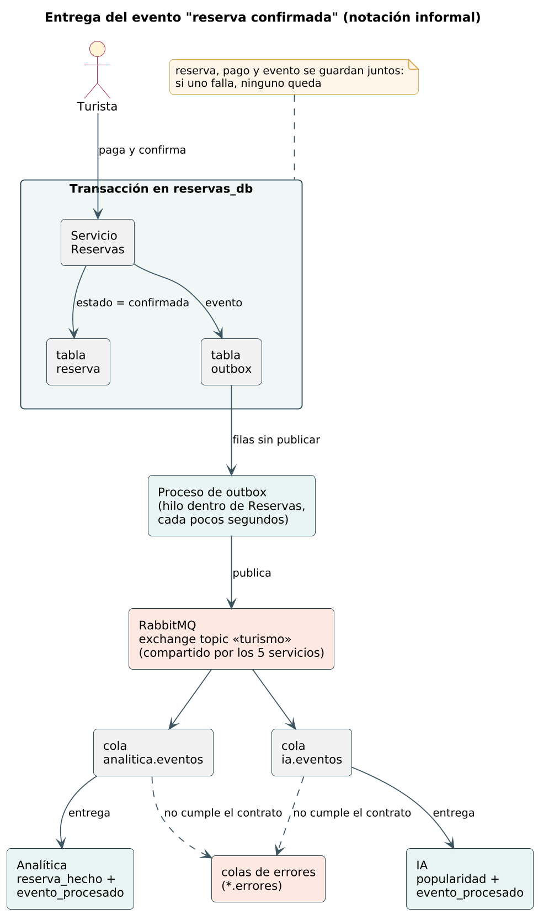
*Figura 1. Entrega del evento de reserva confirmada (notación informal).*

| Elemento | Especificación |
|---|---|
| Productor | Servicio Reservas: escribe `reserva` (estado `confirmada`), `pago` y la fila del `outbox` en una sola transacción de `reservas_db` |
| Proceso de *outbox* | `ProcesadorOutbox` de la plantilla común (`comun.eventos`). Corre como hilo dentro del contenedor de Reservas, lee las filas con `publicado_en` nulo, las publica y las marca. Si la publicación falla, la fila queda pendiente para el siguiente ciclo. |
| *Broker* | RabbitMQ con un único *exchange* de tipo *topic*, `turismo`, compartido por los cinco servicios. La *routing key* es el tipo del evento. |
| Consumidores | Analítica (cola `analitica.eventos`, tabla `reserva_hecho`) e IA (cola `ia.eventos`, popularidad en `proyeccion_oferta`), cada uno con su propia cola |
| Idempotencia | Tabla `evento_procesado` en `analitica_db` y en `ia_db`, insertada en la misma transacción que el efecto (`ConsumidorIdempotente`) |
| Camino de error | El mensaje que no cumple el contrato se rechaza sin reencolar (`nack`) y va a la cola de errores del consumidor (`analitica.eventos.errores`, `ia.eventos.errores`) para revisarlo. Un error temporal (por ejemplo, la base no responde) se reencola y se reintenta. Si RabbitMQ se cae, el consumidor se reconecta solo. |

**Flujo.**
1. El turista paga y Reservas confirma. En una transacción cambia la reserva a `confirmada`, inserta el pago y escribe el evento en `outbox`.
2. El proceso de *outbox* publica las filas con `publicado_en` nulo y las marca.
3. RabbitMQ entrega una copia a la cola de cada consumidor.
4. El consumidor inserta el `evento_id` en `evento_procesado` y aplica el efecto en la misma transacción. Si el evento llega de nuevo, la clave primaria lo rechaza y el efecto no se repite.

Si el *broker* está caído, el evento espera en `outbox` y la reserva sigue confirmada.

**Reflexión.** La notación libre fue la más rápida de entender, pero no distingue lo que ocurre dentro de una transacción de lo que ocurre después: hubo que dibujar un recuadro para la transacción de Reservas y explicarlo en una nota. Tampoco deja claro si RabbitMQ es un componente que procesa o el medio por el que viaja el evento.

### 1.2 Notación semiformal: UML de componentes

Representa el mismo aspecto con componentes, interfaces provistas y requeridas y dependencias. Se eligió el diagrama de componentes porque hace explícito qué ofrece cada elemento y quién depende de quién.

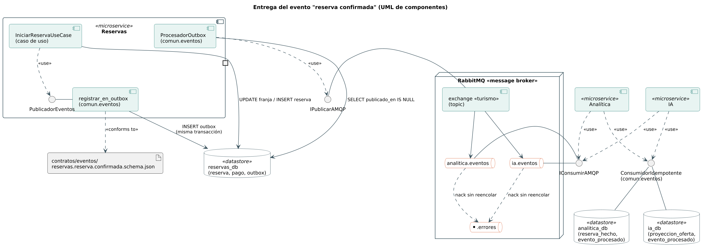
*Figura 2. Entrega del evento de reserva confirmada (UML de componentes).*

| Elemento | Notación UML |
|---|---|
| Servicios | «microservice» Reservas, Analítica e IA. Dentro de Reservas, el caso de uso `IniciarReservaUseCase`, la función `registrar_en_outbox` y el `ProcesadorOutbox` (los dos últimos de la plantilla común). |
| *Broker* | «message broker» RabbitMQ con el *exchange* `turismo`, una cola por consumidor y una cola de errores por consumidor |
| Almacenes | «datastore» `reservas_db` (tablas `reserva`, `pago` y `outbox`), `analitica_db` (`reserva_hecho`, `evento_procesado`) e `ia_db` (`proyeccion_oferta`, `evento_procesado`) |
| Interfaces | `PublicadorEventos` (puerto de salida de la capa de aplicación), `IPublicarAMQP`, `IConsumirAMQP` y `ConsumidorIdempotente` |
| Dependencias | «use» desde cada componente hacia la interfaz que requiere; «conforms to» hacia `contratos/eventos/reservas.reserva.confirmada.schema.json` |
| Notas | Misma transacción para `reserva`, `pago` y `outbox`. Los mensajes inválidos van a `*.errores` sin reintento. |

**Reflexión.** UML resolvió la ambigüedad de RabbitMQ: quedó como componente con puertos, y cada servicio declara la interfaz que requiere. También obligó a separar el `ProcesadorOutbox` del caso de uso, que en la Figura 1 parecían una sola caja. Lo transaccional y lo asíncrono siguen dependiendo de notas.

### 1.3 Notación formal: especificación ACME

Describe en ACME los componentes, conectores, puertos, roles y adjuntos del mismo aspecto. Se eligió ACME por su sintaxis declarativa y porque AcmeStudio permite validarla.

| Elemento | Especificación |
|---|---|
| Familia | `EntregaEventosFam`: 4 tipos de puerto, 2 tipos de rol, 4 tipos de componente y 4 tipos de conector |
| Componentes | `reservas`, `procesoOutbox`, `rabbitMQ`, `analitica`, `ia`, `reservasDb`, `analiticaDb`, `iaDb` |
| Conectores | `escrituraOutbox`, `lecturaOutbox`, `publicacion`, `entregaAnalitica`, `entregaIa`, `registroAnalitica`, `registroIa` |
| Adjuntos | 14, en un bloque `Attachments` (cada uno une el puerto de un componente con el rol de un conector) |
| Propiedades clave | `mismaTransaccion = true`, `exchange = "turismo"`, `errorPermanente = "nack sin reencolar a la cola de errores"`, `clave = "evento_id"`, `garantia = "al menos una vez"` |

```
Family EntregaEventosFam = {
    Port Type PuertoSql = { Property protocolo : string = "PostgreSQL wire (red interna de Docker)"; };
    Port Type PuertoPublicacion = { Property protocolo : string = "AMQP 0-9-1"; };
    Port Type PuertoConsumo = { Property protocolo : string = "AMQP 0-9-1"; };
    Port Type PuertoInterno = { Property tipo : string = "llamada en proceso"; };

    Role Type Emisor = {};
    Role Type Receptor = {};

    Component Type Microservicio = {
        Property lenguaje : string = "Python 3.12 + FastAPI";
        Property capas : string = "dominio, aplicacion, api, infraestructura";
    };
    Component Type ProcesoOutbox = {
        Property implementacion : string = "comun.eventos.ProcesadorOutbox";
        Property ejecucion : string = "hilo dentro del contenedor del productor";
        Property instancias : int = 1;
    };
    Component Type BrokerMensajes = {
        Property exchange : string = "turismo";
        Property tipoExchange : string = "topic";
        Property errorPermanente : string = "nack sin reencolar a la cola de errores";
        Property errorTemporal : string = "reencolar y reintentar";
        Property garantia : string = "al menos una vez";
    };
    Component Type Almacen = { Property motor : string = "PostgreSQL 16"; };

    Connector Type EscrituraTransaccional = {
        Role escritor : Emisor = new Emisor;
        Role tabla : Receptor = new Receptor;
        Property mismaTransaccion : boolean = true;
    };
    Connector Type LecturaPendientes = {
        Role lector : Emisor = new Emisor;
        Role tabla : Receptor = new Receptor;
        Property filtro : string = "publicado_en IS NULL";
    };
    Connector Type PublicacionEvento = {
        Role publicador : Emisor = new Emisor;
        Role exchange : Receptor = new Receptor;
        Property routingKey : string = "reservas.reserva.confirmada";
        Property esquema : string = "contratos/eventos/reservas.reserva.confirmada.schema.json";
    };
    Connector Type EntregaCola = {
        Role cola : Emisor = new Emisor;
        Role consumidor : Receptor = new Receptor;
    };
};

System EntregaReservaConfirmada : EntregaEventosFam = new EntregaEventosFam extended with {
    Component reservas : Microservicio = new Microservicio extended with {
        Port escribirReservaYEvento : PuertoSql = new PuertoSql; };
    Component procesoOutbox : ProcesoOutbox = new ProcesoOutbox extended with {
        Port leerOutbox : PuertoSql = new PuertoSql;
        Port publicar : PuertoPublicacion = new PuertoPublicacion; };
    Component rabbitMQ : BrokerMensajes = new BrokerMensajes extended with {
        Port recibir : PuertoPublicacion = new PuertoPublicacion;
        Port entregarAnalitica : PuertoConsumo = new PuertoConsumo;
        Port entregarIa : PuertoConsumo = new PuertoConsumo; };
    Component analitica : Microservicio = new Microservicio extended with {
        Port consumir : PuertoConsumo = new PuertoConsumo;
        Port registrarEfecto : PuertoSql = new PuertoSql; };
    Component ia : Microservicio = new Microservicio extended with {
        Port consumir : PuertoConsumo = new PuertoConsumo;
        Port registrarEfecto : PuertoSql = new PuertoSql; };
    Component reservasDb : Almacen = new Almacen extended with {
        Port tablasReservaOutbox : PuertoSql = new PuertoSql;
        Property tablas : string = "reserva, pago, outbox"; };
    Component analiticaDb : Almacen = new Almacen extended with {
        Port tablas : PuertoSql = new PuertoSql;
        Property tablas : string = "reserva_hecho, evento_procesado"; };
    Component iaDb : Almacen = new Almacen extended with {
        Port tablas : PuertoSql = new PuertoSql;
        Property tablas : string = "proyeccion_oferta, evento_procesado"; };

    Connector escrituraOutbox : EscrituraTransaccional = new EscrituraTransaccional;
    Connector lecturaOutbox : LecturaPendientes = new LecturaPendientes;
    Connector publicacion : PublicacionEvento = new PublicacionEvento;
    Connector entregaAnalitica : EntregaCola = new EntregaCola;
    Connector entregaIa : EntregaCola = new EntregaCola;
    Connector registroAnalitica : EscrituraTransaccional = new EscrituraTransaccional extended with {
        Property clave : string = "evento_id"; };
    Connector registroIa : EscrituraTransaccional = new EscrituraTransaccional extended with {
        Property clave : string = "evento_id"; };

    Attachments {
        reservas.escribirReservaYEvento to escrituraOutbox.escritor;
        reservasDb.tablasReservaOutbox to escrituraOutbox.tabla;
        procesoOutbox.leerOutbox to lecturaOutbox.lector;
        reservasDb.tablasReservaOutbox to lecturaOutbox.tabla;
        procesoOutbox.publicar to publicacion.publicador;
        rabbitMQ.recibir to publicacion.exchange;
        rabbitMQ.entregarAnalitica to entregaAnalitica.cola;
        analitica.consumir to entregaAnalitica.consumidor;
        rabbitMQ.entregarIa to entregaIa.cola;
        ia.consumir to entregaIa.consumidor;
        analitica.registrarEfecto to registroAnalitica.escritor;
        analiticaDb.tablas to registroAnalitica.tabla;
        ia.registrarEfecto to registroIa.escritor;
        iaDb.tablas to registroIa.tabla;
    };
};
```

**Reflexión.** Lo más difícil de formalizar fue la garantía de "misma transacción": ACME no tiene una construcción para ella y quedó como propiedad del conector.

Al escribir la propiedad `instancias` apareció una restricción de diseño. Hoy el proceso de *outbox* de Reservas corre en **una** instancia y no bloquea filas. Si Reservas se replica (ruta de crecimiento), dos instancias leerían las mismas filas pendientes. Los consumidores descartarían los duplicados, pero se haría trabajo doble. Auth, Catálogo y Analítica ya leen su *outbox* con `SELECT … FOR UPDATE SKIP LOCKED`, y la plantilla común debe adoptar el mismo patrón antes de replicar Reservas.

La cola de errores, que solo existe en el camino de error, quedó reducida a la propiedad `errorPermanente`.

## Punto 2. Vistas estructurales

La plataforma tiene cinco microservicios en Python y FastAPI (Auth, Catálogo, Reservas, IA y Analítica), una PWA en React y TypeScript, y Traefik como API Gateway. Cada servicio tiene su propia base de datos en PostgreSQL 16 y se comunica por REST a través del Gateway o por eventos en RabbitMQ. Todo corre en contenedores con Docker Compose sobre una VM de Azure.

Las vistas muestran:
- cómo se divide el código;
- cómo interactúa en ejecución;
- dónde se despliega y quién lo construye;
- qué elementos sostienen los dos atributos críticos.

### 2.1 Vista de módulo

Muestra cómo se divide el código del *monorepo* en unidades de implementación y cómo se relacionan. Se dividió en dos figuras: los módulos de primer nivel y la estructura interna del servicio Reservas, dueño del flujo crítico.

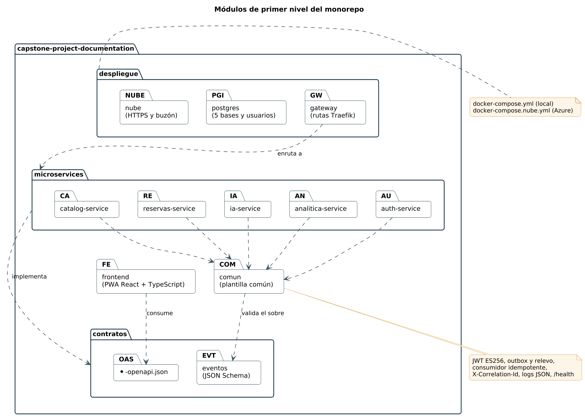
*Figura 3. Módulos de primer nivel.*

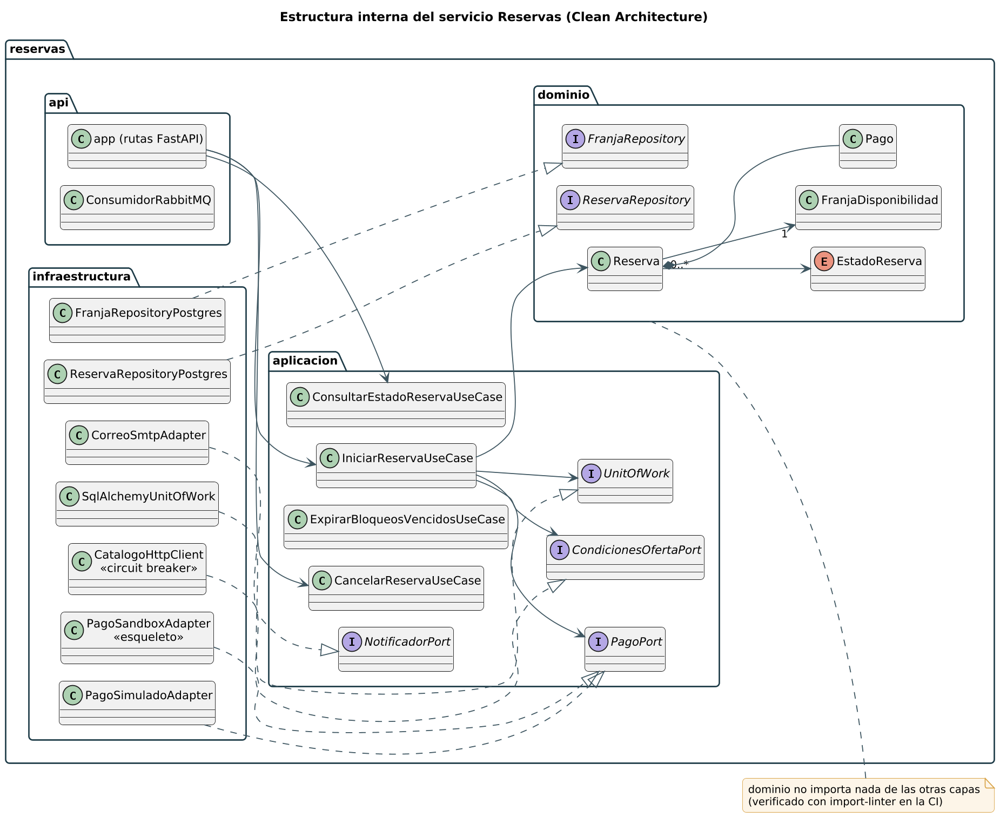
*Figura 4. Estructura interna del servicio Reservas (Clean Architecture).*

| Elemento | Especificación |
|---|---|
| Módulos de primer nivel | `microservices/auth-service`, `microservices/catalog-service`, `microservices/reservas-service`, `microservices/ia-service`, `microservices/analitica-service`, `frontend` y `despliegue` |
| Módulos de apoyo | `comun` (plantilla común: JWT ES256, *outbox* y relevo, consumidor idempotente, `X-Correlation-Id`, logs JSON, *healthcheck*) y `contratos` (OpenAPI por servicio y esquemas JSON de eventos) |
| Relaciones | *is-part-of* (contención), *depends-on* (flecha punteada), *implements* (realización de un puerto por un adaptador) |
| Módulo de segundo nivel | Reservas: capas `api`, `aplicacion`, `dominio`, `infraestructura`. La regla de dependencia apunta siempre hacia `dominio` y se verifica con `import-linter` en la CI. |
| Regla clave | Ningún servicio depende del código de otro servicio: solo de `contratos` y de `comun` |

| Módulo | Responsabilidad principal | Depende de |
|---|---|---|
| `auth-service` | Registro con confirmación de correo, sesiones con JWT ES256 (15 min), roles, verificación de prestadores (RNT), consentimiento versionado (Ley 1581) y registro de auditoría | `contratos`, `comun` |
| `catalog-service` | Ofertas con atributos JSONB, tarifas, políticas de cancelación, calificaciones, zonas y lotes de sincronización | `contratos`, `comun` |
| `reservas-service` | Cupos con actualización condicional atómica, pago por puerto con adaptador simulado, lista de espera, cancelaciones, disputas y correos | `contratos`, `comun` |
| `ia-service` | Recomendación multicriterio explicable sobre una proyección local de la oferta | `contratos`, `comun` |
| `analitica-service` | Indicadores, capacidad de carga por zona y alertas | `contratos`, `comun` |
| `despliegue/gateway` | Rutas `/api/v1/*` de Traefik hacia cada servicio, con *health checks* | `contratos` (OpenAPI) |
| `frontend` | PWA web y móvil bilingüe; la aplicación y las fotos quedan en caché (Workbox) | `contratos` (OpenAPI) |

### 2.2 Vista de componentes y conectores

Muestra los componentes en ejecución cuando un turista confirma una reserva (CU-11), el flujo que más presiona la arquitectura.

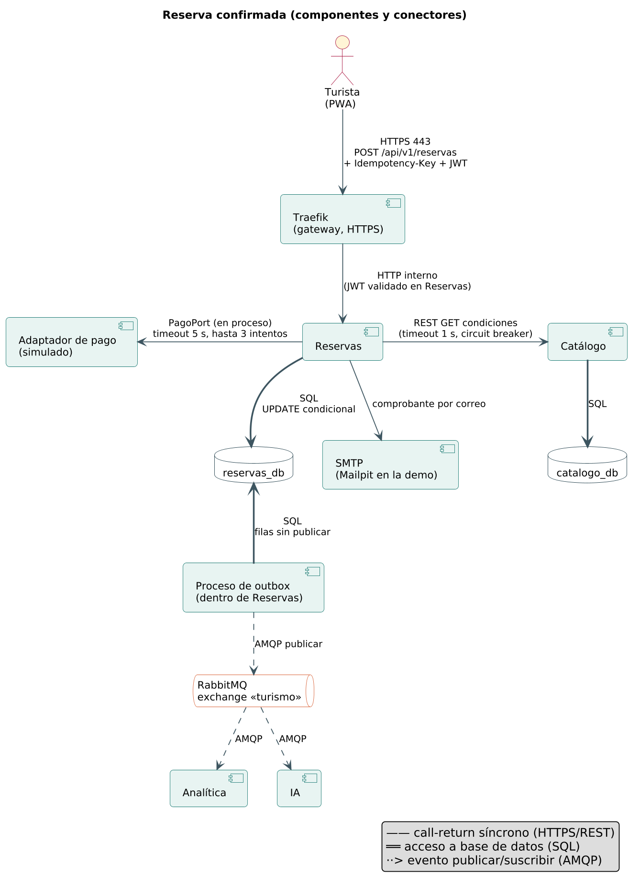
*Figura 5. Reserva confirmada (componentes y conectores).*

| Símbolo | Tipo de conector | Dónde aparece |
|---|---|---|
| Línea continua | *Call-return* síncrono (HTTPS/REST, JSON con OpenAPI) | PWA → Traefik → Reservas; Reservas → Catálogo |
| Línea doble | Acceso a base de datos (SQL) | Reservas → `reservas_db`; Catálogo → `catalogo_db` |
| Línea punteada | Evento publicar/suscribir (AMQP) | Proceso de *outbox* → RabbitMQ → Analítica e IA |
| Llamada en proceso | Puerto de pago (interfaz `PagoPort`) | Reservas → `PagoSimuladoAdapter` |

**Flujo.**
1. La PWA envía `POST /api/v1/reservas` con una `Idempotency-Key`.
2. Traefik enruta a Reservas, que valida el JWT con la plantilla común.
3. Reservas pide a Catálogo las condiciones de la oferta (*timeout* de 1 s y *circuit breaker*).
4. Descuenta el cupo con un `UPDATE` condicional.
5. Cobra por el puerto de pago (*timeout* de 5 s, hasta 3 intentos).
6. Confirma la reserva junto con su evento en `outbox` y envía el comprobante por correo.

Analítica e IA se enteran después, por RabbitMQ.

**Protocolo del conector principal.** `POST /reservas` usa HTTPS desde el dispositivo hasta Traefik (certificado de Let's Encrypt) y HTTP dentro de la red interna de Docker hasta el contenedor, con JSON descrito en OpenAPI. Se eligió REST porque el turista necesita la respuesta para continuar (ADR-04). La `Idempotency-Key` hace que un reintento por fallo de red devuelva la misma reserva en lugar de crear otra.

### 2.3 Vista de alocación

Muestra dónde se ejecuta cada componente, dónde se guarda cada dato y quién construye cada módulo. Se dividió en tres figuras: el despliegue del prototipo, el entorno local y la asignación de trabajo.

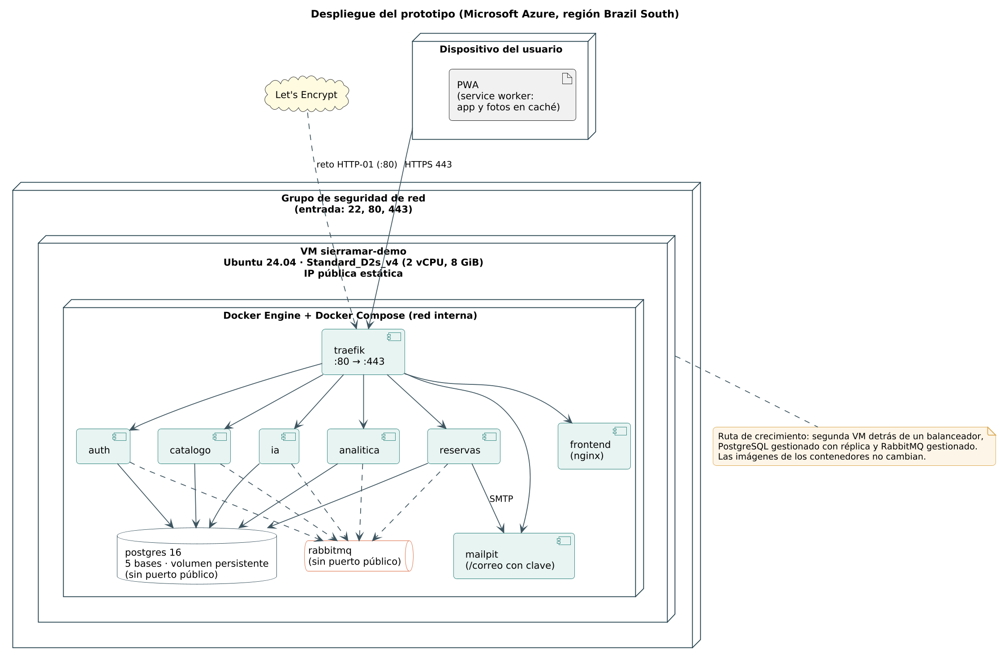
*Figura 6. Despliegue del prototipo en la nube.*

| Dato | Almacén (*stored-in*) |
|---|---|
| Usuarios, consentimientos, verificaciones y auditoría | `auth_db` (PostgreSQL) |
| Ofertas, tarifas, calificaciones y zonas | `catalogo_db` (PostgreSQL + JSONB). Las fotos de los destinos van empaquetadas en la PWA. |
| Franjas, reservas, pagos, lista de espera y notificaciones | `reservas_db` (PostgreSQL) |
| Proyección de ofertas, estado de zonas, pesos y recomendaciones | `ia_db` (PostgreSQL) |
| Hechos de reserva, indicadores, umbrales y alertas | `analitica_db` (PostgreSQL) |
| Eventos en tránsito | RabbitMQ (contenedor); antes de publicarse, en la tabla `outbox` de cada base |

| Elemento | Especificación |
|---|---|
| Nodos | Una VM de Azure (Brazil South), Ubuntu 24.04, Standard_D2s_v4 (2 vCPU, 8 GiB), con IP pública estática. Dentro corren 10 contenedores: Traefik, frontend, los 5 servicios, RabbitMQ, PostgreSQL y Mailpit. |
| Red | Un grupo de seguridad de red solo admite 22, 80 y 443. Solo Traefik publica puertos; RabbitMQ y PostgreSQL quedan en la red interna de Docker. |
| Recuperación | Los contenedores se reinician solos (`restart: unless-stopped`) y PostgreSQL guarda en un volumen persistente. La VM es el punto único de falla del prototipo. |
| Servicios externos | Let's Encrypt (certificado TLS). Pasarela de pagos simulada (adaptador *sandbox* previsto). Mailpit hace de servidor de correo de la demostración. |
| Costo | 0,153 USD/h ≈ USD 112 al mes, ≈ 1,7 % del techo de USD 20.000 en los 3 meses del proyecto (ADR-08) |
| Ruta de crecimiento (*migrates-to*) | Segunda VM detrás de un balanceador, PostgreSQL gestionado con réplica en espera y RabbitMQ gestionado. Las imágenes de los contenedores no cambian. |

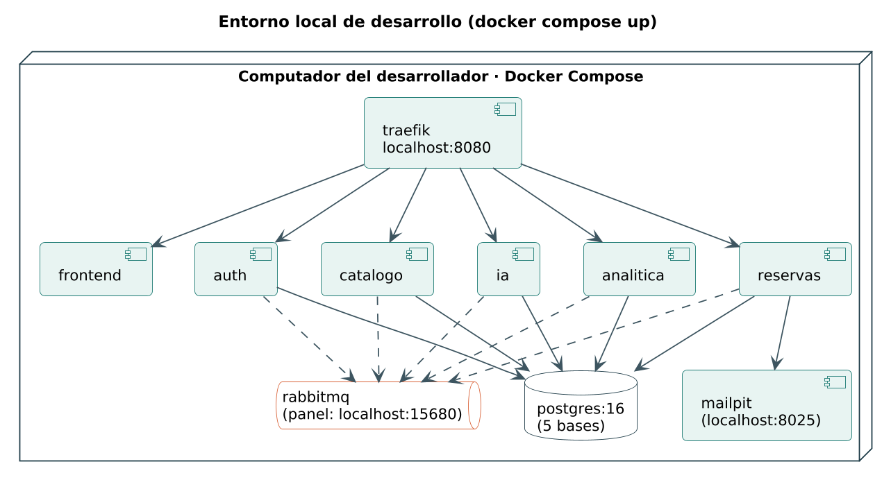
*Figura 7. Entorno local de desarrollo.*

En local, cada integrante levanta todo con `docker compose up`: los mismos contenedores, con el gateway en `localhost:8080`, el panel de RabbitMQ en `localhost:15680` y Mailpit en `localhost:8025`. La diferencia con la nube es el archivo `docker-compose.nube.yml`, que agrega HTTPS, cierra los paneles y protege el buzón con clave (ADR-08).

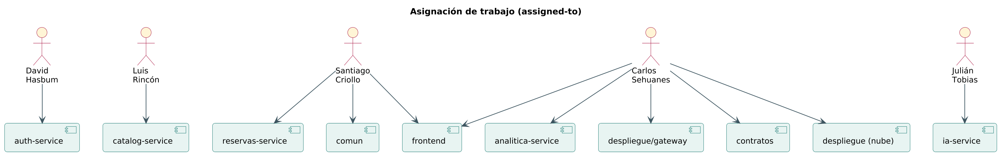
*Figura 8. Asignación de trabajo.*

| Módulo / carpeta | Responsable (*assigned-to*) |
|---|---|
| `microservices/auth-service/` | David Hasbum |
| `microservices/catalog-service/` | Luis Rincón |
| `microservices/reservas-service/`, `comun/` | Santiago Criollo |
| `microservices/ia-service/` | Julián Tobias |
| `microservices/analitica-service/`, `despliegue/gateway/`, `contratos/`, `despliegue/` | Carlos Sehuanes (arquitecto) |
| `frontend/` | Santiago Criollo y Carlos Sehuanes (sprint 5, plan de desarrollo) |

> **Por confirmar.** Las responsabilidades sobre `contratos/` y `despliegue/` se asignaron al arquitecto por su rol; el plan de desarrollo no las nombra explícitamente.

### 2.4 Vistas de calidad

Los dos atributos críticos son **disponibilidad** (EC-DISP-01, restricción RC-T04) y **desempeño bajo concurrencia** (EC-DESM-01, restricción RC-T03). Cada vista toma de las anteriores los elementos que sostienen el atributo y explica, con una nota numerada, cómo contribuye cada uno.

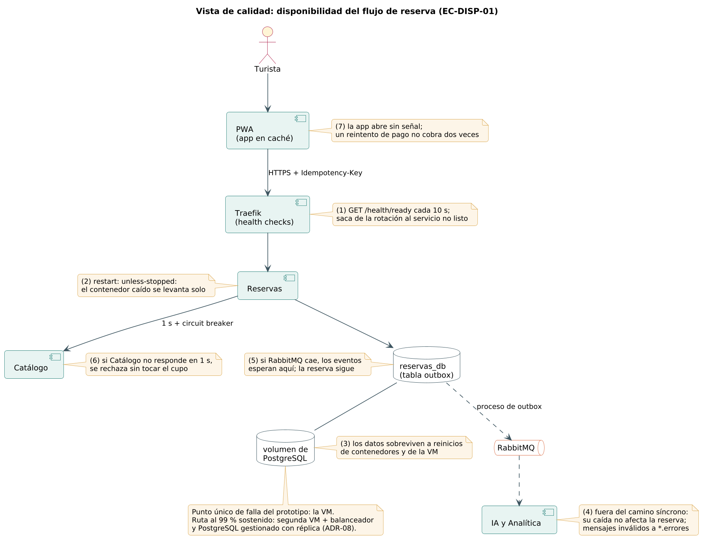
*Figura 9. Vista de calidad: disponibilidad del flujo de reserva.*

| Elemento | Especificación |
|---|---|
| Atributo | Disponibilidad (EC-DISP-01) |
| Escenario | Pico de consultas y reservas en temporada alta; falla uno de los servicios o el *broker* |
| Medida | Disponibilidad mensual ≥ 99 % (≈ 7,3 h de indisponibilidad máxima); la reserva sigue funcionando aunque IA, Analítica o RabbitMQ estén caídos |
| Dirigida a | Administrador de la plataforma y Entidad de Gestión del Destino |
| Elementos | (1) Traefik con *health checks* que saca de la rotación al servicio no listo<br>(2) Reinicio automático de contenedores<br>(3) Volumen persistente de PostgreSQL<br>(4) IA y Analítica fuera del camino síncrono<br>(5) *Outbox* que absorbe la caída del *broker*<br>(6) *Circuit breaker* hacia Catálogo<br>(7) PWA que abre sin señal e `Idempotency-Key` contra cobros dobles |
| Límite actual | La VM es el punto único de falla. El 99 % sostenido exige la ruta de crecimiento: segunda VM y PostgreSQL con réplica. |

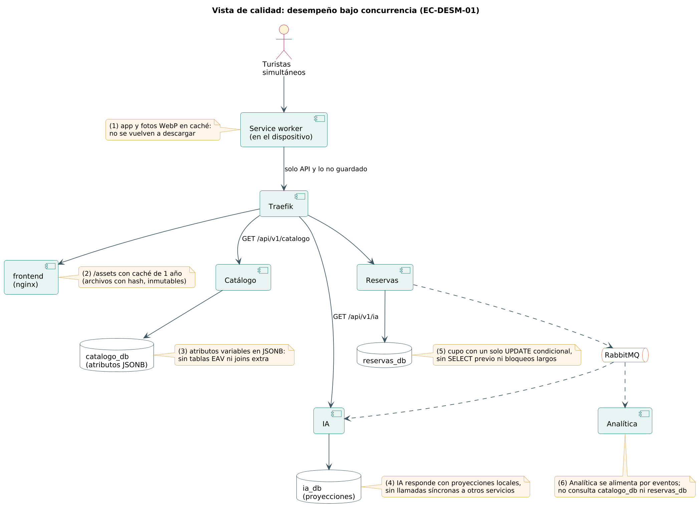
*Figura 10. Vista de calidad: desempeño bajo concurrencia.*

| Elemento | Especificación |
|---|---|
| Atributo | Eficiencia de desempeño (EC-DESM-01) |
| Escenario | 500 usuarios simultáneos consultan el catálogo y las recomendaciones en temporada alta |
| Medida | p95 < 800 ms y p99 < 1.500 ms (meta, aún sin medir) |
| Dirigida a | Turista y Equipo de Desarrollo |
| Elementos | (1) Aplicación y fotos WebP en la caché del *service worker*<br>(2) Recursos estáticos con caché de un año en nginx<br>(3) Atributos variables en JSONB, sin tablas EAV<br>(4) IA responde con proyecciones locales, sin llamadas síncronas<br>(5) Cupo con un solo `UPDATE` condicional<br>(6) Analítica alimentada por eventos, sin consultar otras bases |
| Ruta de crecimiento | Réplicas de Catálogo e IA detrás de Traefik, caché de búsquedas e índices GIN sobre JSONB cuando la medición lo justifique |

## Punto 3. Vista combinada

Superpone los componentes y conectores de la reserva confirmada (Figura 5) sobre el nodo del despliegue (Figura 6).

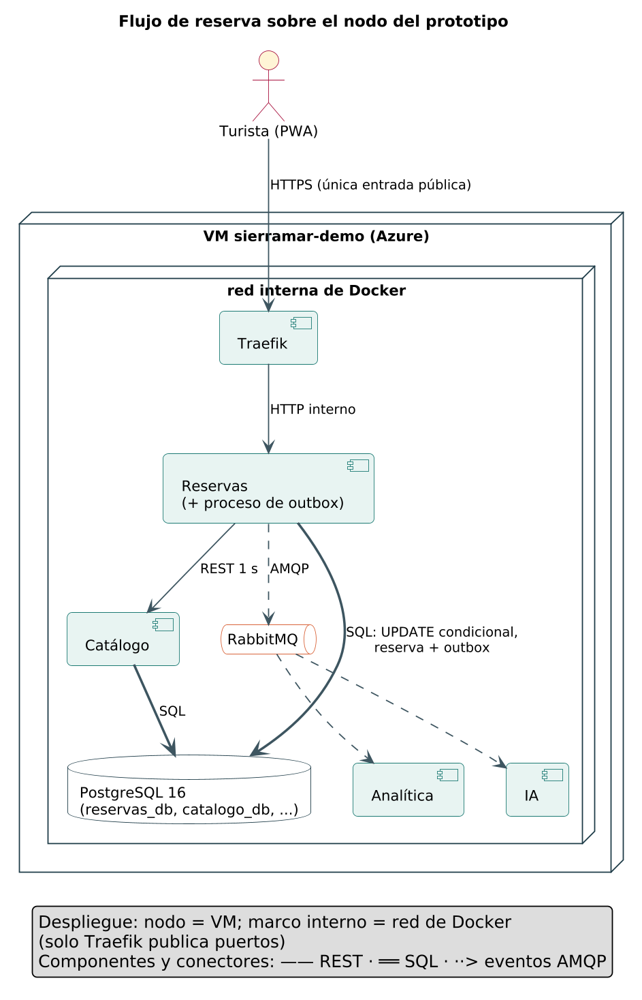
*Figura 11. Flujo de reserva sobre el nodo del prototipo.*

| Elemento | Especificación |
|---|---|
| Vistas combinadas | Componentes y conectores + alocación (despliegue) |
| Incluye | Traefik, Reservas con su proceso de *outbox*, Catálogo, RabbitMQ, PostgreSQL, Analítica e IA, todos en la red interna de Docker de la VM |
| Omite | Auth (solo emite el token, que la plantilla común valida localmente), frontend, Mailpit y observabilidad, para no sobrecargar la vista |
| Leyenda | Elementos de despliegue (nodo y red interna) y estilos de línea de la Figura 5 |

**Justificación.** La disponibilidad y el desempeño dependen de dónde corre cada componente. Ninguna vista por separado lo muestra; la superposición deja ver tres cosas:

- **Toda la reserva ocurre dentro de un solo host.** Las llamadas Traefik → Reservas → Catálogo y Reservas → PostgreSQL no cruzan la red pública, así que la latencia de red es mínima. A cambio, la VM es el punto único de falla.
- **Solo Traefik es alcanzable desde internet.** RabbitMQ y PostgreSQL no publican puertos, lo que reduce la superficie de ataque y cumple RC-N01.
- **El único elemento con estado en el camino crítico es PostgreSQL.** Por eso su volumen persistente es lo que se respalda, y una réplica gestionada es la primera inversión de la ruta de crecimiento (ADR-08).

## Punto 4. Comportamiento

### 4.1 Diagrama de secuencia

Traza el flujo crítico CU-11 (reservar una experiencia). Se dividió en dos figuras, enlazadas con un fragmento `ref`: la orquestación completa y el procesamiento del pago.

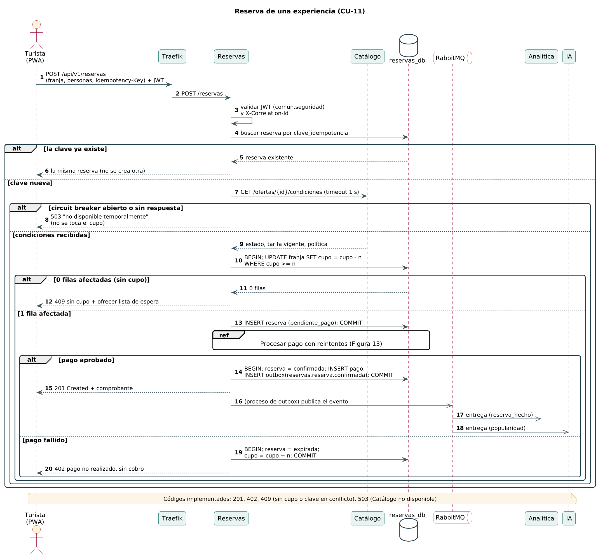
*Figura 12. Reserva de una experiencia (CU-11).*

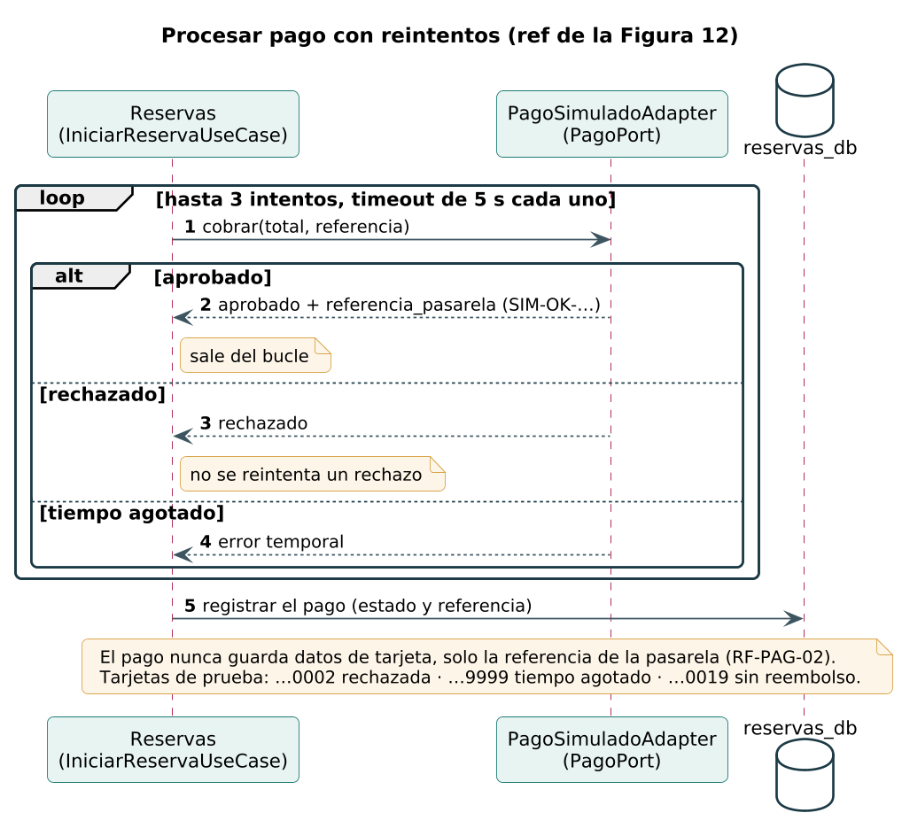
*Figura 13. Procesamiento del pago con reintentos.*

| Elemento | Especificación |
|---|---|
| Escenario | Un turista reserva una franja con cupo limitado, con otros turistas compitiendo por el mismo cupo |
| *Lifelines* | Turista (PWA), Traefik, Reservas, Catálogo, `reservas_db`, RabbitMQ, Analítica e IA (Figura 12); Reservas, `PagoSimuladoAdapter` y `reservas_db` (Figura 13) |
| Fragmentos | En la Figura 12: `alt` clave de idempotencia repetida, `alt` *circuit breaker* abierto hacia Catálogo, `alt` sin cupo (lista de espera), `ref` al procesamiento del pago y `alt` pago aprobado o fallido. En la Figura 13: `loop` de hasta 3 intentos con `alt` por resultado. |
| Códigos HTTP | 201 (creada), 402 (pago rechazado, con comprobante), 409 (sin cupo o clave de idempotencia en conflicto), 503 (Catálogo no disponible) |
| Notación | Línea continua con punta llena: llamada síncrona. Punta abierta: mensaje asíncrono (publicación y entrega de eventos). Línea punteada: respuesta. |
| Propiedad | Consistencia del cupo (0 sobreventas) y aislamiento de fallos |

**Flujo.**
1. Reservas valida el JWT con la plantilla común. Si la `Idempotency-Key` ya existe, devuelve la reserva creada antes.
2. Si la clave es nueva, pide a Catálogo las condiciones (1 s). Con el *circuit breaker* abierto, responde 503 sin tocar el cupo.
3. Ejecuta el `UPDATE` condicional:
   - si afecta 0 filas, no hay cupo: responde 409 y ofrece la lista de espera;
   - si afecta 1 fila, inserta la reserva en `pendiente_pago`.
4. Procesa el pago:
   - **aprobado:** confirma la reserva y escribe el evento en `outbox` en una sola transacción, y responde 201;
   - **fallido:** marca la reserva `expirada`, devuelve el cupo y responde 402.

Analítica e IA reciben el evento después. Si están caídos, la reserva ya está confirmada y el evento espera en su cola.

**Por qué dos turistas no obtienen el último cupo.** `UPDATE franja_disponibilidad SET cupo_disponible = cupo_disponible - :n WHERE id = :franja AND cupo_disponible >= :n` es atómico en PostgreSQL: de dos solicitudes concurrentes solo una afecta la fila. La restricción `ck_franja_cupo_valido` (`0 <= cupo_disponible AND cupo_disponible <= cupo_total`) es la segunda barrera.

### 4.2 Máquina de estados

Modela el ciclo de vida de una reserva, desde que se bloquea el cupo hasta que se completa, expira o se cancela. Se eligió porque las reglas más delicadas del sistema (cupo, pago, reembolso, calificaciones) dependen del estado de la reserva.

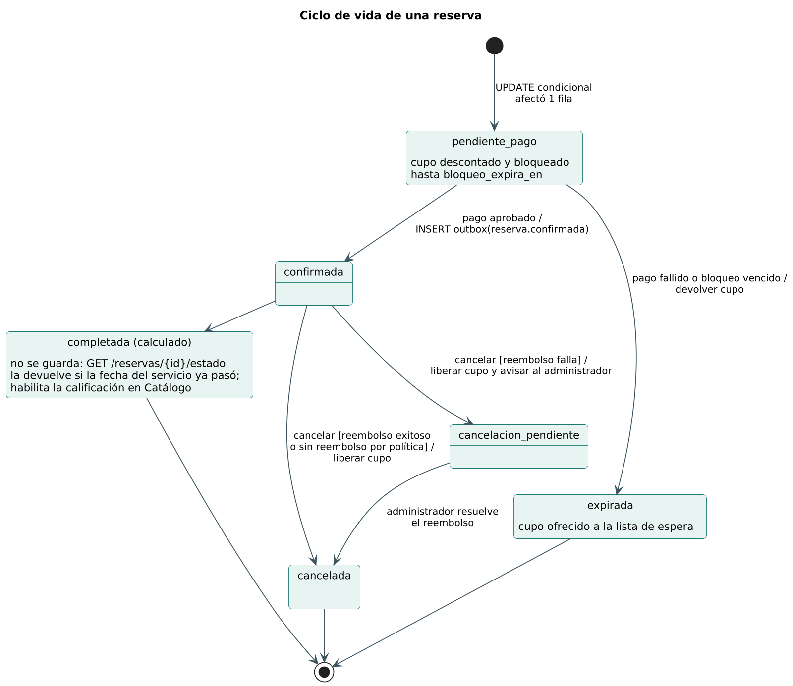
*Figura 14. Ciclo de vida de una reserva.*

| Estado | Significado |
|---|---|
| `pendiente_pago` | Cupo descontado y bloqueado hasta `bloqueo_expira_en`; el pago está en curso |
| `confirmada` | Pago aprobado; el cupo queda firme y se publicó `reservas.reserva.confirmada` |
| `cancelacion_pendiente` | El turista canceló y el cupo se liberó, pero el reembolso falló; se avisó al administrador (RF-RES-14) |
| `expirada` (final) | Pago fallido o bloqueo vencido; el cupo se devolvió y se ofrece al primero de la lista de espera |
| `cancelada` (final) | Cancelación aplicada según la política copiada en la reserva, con reembolso si corresponde; cupo liberado |
| `completada` (calculado) | No se guarda en la base: `GET /reservas/{id}/estado` la devuelve cuando la reserva está confirmada y la fecha del servicio ya pasó. Habilita la calificación en Catálogo (RF-CAT-15). |

**Flujo.**
- Una reserva nace en `pendiente_pago` solo si el `UPDATE` condicional afectó una fila.
- El pago aprobado la lleva a `confirmada`. El pago fallido o la tarea `ExpirarBloqueosVencidosUseCase` la llevan a `expirada`.
- Desde `confirmada`, una cancelación con reembolso exitoso (o sin reembolso por política) termina en `cancelada`. Si el reembolso falla, la reserva espera en `cancelacion_pendiente` hasta que el administrador lo resuelva.

> **Decisión deliberada: la política se copia en la reserva.** Al reservar, la reserva guarda el precio y la política de cancelación vigentes en sus propias columnas: `precio_unitario_copiado`, `pol_horas_reembolso_total`, `pol_horas_reembolso_parcial` y `pol_porcentaje_reembolso_parcial`. Si el prestador cambia su política después, la cancelación respeta las condiciones que el turista aceptó (RF-RES-13).

> **Decisión deliberada: `completada` se calcula, no se guarda.** Así no hace falta una tarea periódica que recorra las reservas, y el estado nunca queda desactualizado: Catálogo lo consulta cuando el turista va a calificar y la respuesta depende solo de la fecha del servicio.

## Punto 5. Más allá de las vistas

### 5.1 Mapeo entre vistas

Relaciona cada módulo de la vista de módulo con su implementación, despliegue, almacenamiento y responsable en la vista de alocación.

| Elemento (vista de módulo) | Relación | Elemento (vista de alocación) | Anotación |
|---|---|---|---|
| Auth | *is-implemented-by* | `microservices/auth-service/` | Clean Architecture; registro, confirmación de correo, sesiones y verificación de prestadores |
| Auth | *allocated-to* | Contenedor `auth` en la VM | Publica la clave pública en `/.well-known/jwks.json` |
| Auth | *stored-in* | `auth_db` | `registro_auditoria` y `consentimiento` versionado |
| Auth | *assigned-to* | David Hasbum | Dueño del servicio Auth |
| Catálogo | *allocated-to* | Contenedor `catalogo` en la VM | Atiende la llamada síncrona de Reservas (1 s) |
| Catálogo | *stored-in* | `catalogo_db` (JSONB) | `imagen_oferta` admite imágenes propias de cada oferta |
| Catálogo | *assigned-to* | Luis Rincón | Dueño del servicio Catálogo |
| Reservas | *allocated-to* | Contenedor `reservas` en la VM | El proceso de *outbox*, la expiración de bloqueos y el envío de correos corren como hilos del mismo contenedor |
| Reservas | *stored-in* | `reservas_db` | `reserva.clave_idempotencia` única; `CHECK` sobre el cupo |
| Reservas, `comun` | *assigned-to* | Santiago Criollo | Desarrollador principal; dueño del flujo crítico CU-11 |
| IA | *allocated-to* | Contenedor `ia` en la VM | Sin llamadas síncronas a otros servicios |
| IA | *stored-in* | `ia_db` | Pesos versionados en `configuracion_criterios`; cada recomendación guarda su desglose |
| IA | *assigned-to* | Julián Tobias | Dueño del servicio IA |
| Analítica | *allocated-to* | Contenedor `analitica` en la VM | Recalcula la ocupación cada 60 s; lee su *outbox* con `SKIP LOCKED` |
| Analítica | *stored-in* | `analitica_db` | `reserva_hecho` alimentado por eventos |
| Analítica, gateway | *assigned-to* | Carlos Sehuanes | Arquitecto; Traefik como única entrada |
| `frontend` | *allocated-to* | Contenedor `frontend` (nginx) y navegador del usuario | *Service worker* con Workbox: aplicación y fotos disponibles sin conexión; el comprobante también llega por correo |

### 5.2 Guía de variabilidad

| Campo | Adaptador de pago (`PagoPort`) |
|---|---|
| Ubicación | Servicio Reservas: puerto `PagoPort` en la capa de aplicación; adaptadores en `infraestructura/adaptadores.py` |
| Variantes | `PagoSimuladoAdapter` (prototipo, en uso), `PagoSandboxAdapter` (esqueleto para Wompi o ePayco de pruebas, aún sin implementar) y un adaptador de producción futuro |
| Activación | Hoy el adaptador se elige al ensamblar los casos de uso en `main.py`. Propuesta: una variable de entorno `ADAPTADOR_PAGO` en el archivo de cada entorno, para cambiarlo sin tocar código (por implementar). |
| Restricción | `IniciarReservaUseCase`, `CancelarReservaUseCase` y `Reserva` no cambian. Ningún adaptador guarda datos de tarjeta, solo la referencia de la pasarela (RF-PAG-02). Se conservan el *timeout* de 5 s y los 3 intentos. |
| Audiencia | Operaciones, CI/CD y docente evaluador (demuestra que la pasarela real no toca el núcleo) |

| Campo | `VERSION_CRITERIOS_IA` |
|---|---|
| Ubicación | Servicio IA, tabla `configuracion_criterios` en `ia_db` |
| Variantes | Cada versión de los pesos de afinidad, calidad bayesiana, descongestión y sostenibilidad; la v1 es 0,45 · 0,25 · 0,20 · 0,10 |
| Activación | Insertar una versión nueva (nunca editar una existente) y marcarla como vigente |
| Restricción | Solo los cuatro criterios de ADR-07; ningún criterio por tamaño o antigüedad del prestador (RC-ET02). Cada recomendación guarda la versión con que se calculó y su desglose. |
| Audiencia | Responsable de IA, administrador y Entidad de Gestión del Destino |

### 5.3 ADR-10: control de concurrencia del cupo con actualización condicional atómica

**Estado.** Aceptada e implementada en Reservas (`FranjaRepositoryPostgres`). Formaliza una regla que antes solo aparecía en el modelo de datos.

**Contexto.** RF-RES-07 exige que nunca se confirmen más reservas que el cupo, incluso con solicitudes concurrentes. En temporada alta, varios turistas compiten por las mismas franjas (EC-DISP-01). Además, la ruta de crecimiento prevé varias réplicas de Reservas, así que un bloqueo en memoria no sirve. El equipo tiene 12 semanas y 5 integrantes.

**Decisión.** El cupo se descuenta con una sola sentencia, dentro de la transacción que inserta la reserva en `pendiente_pago`:

`UPDATE franja_disponibilidad SET cupo_disponible = cupo_disponible - :n WHERE id = :franja AND cupo_disponible >= :n`

Si afecta 0 filas, no hay cupo. La restricción `ck_franja_cupo_valido` (`0 <= cupo_disponible <= cupo_total`) es la segunda barrera.

**Consecuencias.**

- Positiva: la garantía la da PostgreSQL, no el código de la aplicación; funciona igual con una o más réplicas de Reservas.
- Positiva: una sola consulta corta, sin `SELECT` previo ni bloqueos largos. La reserva en grupo (CU-12) es la misma operación con varias personas: todo o nada.
- Positiva: es fácil de probar con solicitudes paralelas contra una base real.
- Negativa: con mucha contención sobre la misma franja, las transacciones se serializan en esa fila; es aceptable a la escala del piloto.
- Negativa: el cupo se descuenta antes del pago. Si el pago falla o el bloqueo vence, hay que devolverlo (`ExpirarBloqueosVencidosUseCase`).

**Alternativas descartadas.**

- **`SELECT … FOR UPDATE` y luego `UPDATE`:** es correcto, pero son dos viajes a la base con la fila bloqueada entre ambos, y un error de código entre los dos pasos rompe la garantía.
- **Versión optimista (columna `version` y reintento):** obliga a reintentar en la aplicación justo cuando hay más contención.
- **Bloqueo distribuido en una caché (Redis o Valkey):** agrega una dependencia al flujo crítico, y una caché puede perder datos.
- **Aislamiento `SERIALIZABLE` en toda la transacción:** produce fallas de serialización que también hay que reintentar, y afecta a toda la transacción en lugar de una fila.

## Punto 6. Trazabilidad con los stakeholders

### 6.1 Stakeholders y documentación

Los identificadores SH-01 a SH-14 son los del documento de stakeholders del Entregable 2.

| Stakeholder | Rol / interés principal | Artefactos útiles | Información específica que busca |
|---|---|---|---|
| SH-01 Turista | Consulta, reserva y recibe recomendaciones | 4.1, 4.2, 2.4 | 4.1: que el último cupo no se vende dos veces y que un reintento de red no crea una segunda reserva. 4.2: qué pasa con su dinero si cancela o si el pago falla. 2.4: que la app abre con mala señal y el comprobante le llega por correo. |
| SH-02 Pequeño/mediano prestador | Publica su oferta y gestiona cupos | 4.2, 5.2, 2.2 | 4.2: que la política de cancelación aceptada se respeta aunque la cambie después. 5.2 (`VERSION_CRITERIOS_IA`): que ningún criterio favorece a prestadores grandes. 2.2: que sus cupos se descuentan en el momento de la reserva. |
| SH-03 Hotel / operador establecido | Sincroniza inventario y consulta ocupación | 2.1, 2.3 | 2.1: que Catálogo expone lotes de sincronización por contrato OpenAPI. 2.3: dónde se guardan sus datos y quién los puede leer. |
| SH-04 Administrador de la plataforma | Operación, verificación de prestadores y disputas | 2.3, 3, 2.4, 1, 4.2 | 2.3 y 3: qué corre en la VM y qué pasa si un contenedor cae. 2.4: qué elementos vigilar. 1: qué hacer con las colas de errores. 4.2: cuándo una cancelación queda pendiente y le toca resolverla. |
| SH-05 Equipo de desarrollo | Construye, despliega y mantiene | 2.1, 2.3, 5.1, 1.3, 5.3 | 2.1: qué módulo depende de cuál y qué capas respetar. 2.3 y 5.1: quién responde por cada carpeta y dónde guarda sus datos. 1.3: el contrato formal del *outbox* y la restricción antes de replicar Reservas. 5.3: por qué el cupo se controla con un `UPDATE` condicional. |
| SH-06 Docente evaluador | Evalúa la arquitectura y la justificación | 1, 2.4, 3, 5.3 | 1: dominio de tres notaciones sobre un mismo aspecto. 2.4 y 3: cómo la arquitectura atiende los atributos críticos y cuáles son sus límites actuales. 5.3: una decisión con alternativas y consecuencias. |
| SH-07 Entidad de Gestión del Destino | Gobernanza, capacidad de carga e indicadores | 2.4, 2.2, 5.2 | 2.4: qué falta para soportar el pico de temporada (ruta de crecimiento). 2.2: que Analítica recibe las reservas por eventos sin frenar el flujo. 5.2: cómo se cambian los pesos de la IA. |
| SH-09 Autoridad de protección de datos | Cumplimiento de la Ley 1581 | 2.3, 1.2 | 2.3: que los datos personales viven solo en `auth_db` y en la reserva, y que solo Traefik es accesible desde internet. 1.2: que los eventos viajan por la red interna. |
| SH-10 Proveedor de nube | Infraestructura | 2.3, 3 | 2.3 y 3: qué recursos se usan hoy (una VM, IP pública, grupo de seguridad) y cuáles prevé la ruta de crecimiento |
| SH-12 Servicio externo de pagos | Procesa cobros y reembolsos | 4.1, 5.2 | 4.1 (Figura 13): patrón de llamadas, *timeout* de 5 s y hasta 3 intentos. 5.2: cómo se conecta su *sandbox* sin tocar el núcleo. |
| SH-13 Servicio de IA de recomendación | Componente interno que recomienda | 1, 5.2, 2.4 | 1: que recibe las reservas por eventos y descarta duplicados. 5.2: cómo se versionan sus pesos. 2.4: que su caída no afecta la reserva. |

### 6.2 Análisis de cobertura

**¿Hay algún stakeholder sin un artefacto útil?** Sí, tres:

- **Autoridad Ambiental (SH-08):** no tiene una vista que muestre cómo una alerta de capacidad de carga llega a los administradores y a la IA.
- **MinTIC (SH-11):** no tiene artefactos, aunque su interés es bajo.
- **Usuarios con discapacidad o baja alfabetización (SH-14):** no están cubiertos, porque ninguna vista trata la accesibilidad.

Convendría agregar una secuencia de la alerta de capacidad (RF-ANA-05, < 5 min) y una nota de accesibilidad en la vista de módulo de `frontend`.

**¿Hay algún artefacto sin stakeholder?** No. La especificación ACME es la de menor audiencia: solo la usan el equipo de desarrollo y el docente evaluador, y podría reducirse a los conectores del *outbox*.
